# inventwo Widgets for ioBroker vis 2.0

**Build dashboards that look exactly the way you want.** A set of 11 widgets for **ioBroker vis 2.0** with one idea: every widget can be styled down to the last detail - colors and gradients, shapes, shadows, borders, fonts, sizes - without a single line of CSS.

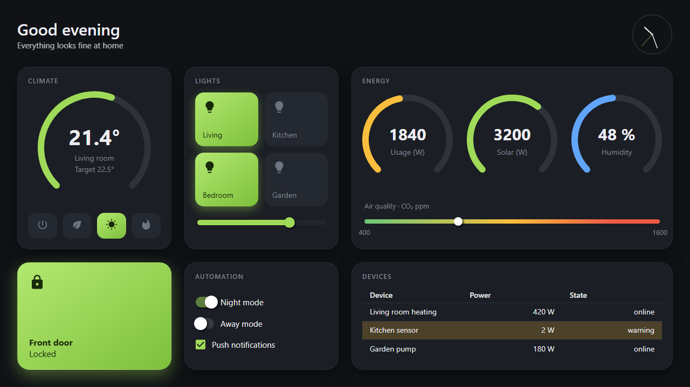

📖 **[User Documentation](docs/README.md)** - detailed guides for all widgets, settings and examples.

---

## Why these widgets?

- 🎨 **Total design freedom** - gradients, glow, glass, neumorphism, hexagons, stars or your own polygon. Every color field accepts any CSS color, including `linear-gradient(...)`.
- 🧩 **One widget, many jobs** - the [Universal widget](#universal) is a switch, button, navigation tile, status display, dialog opener, color picker, clock and more, with its own look for every state.
- 📊 **Show data, don't just switch it** - gauges with color zones, scales and needles, sliders, tables with conditional row colors, calendars, event lists, tickers.
- 🔒 **Safe for wall panels** - password/PIN protection for any action, read-only modes, "hold to activate" buttons, automatic value reset.
- ♻️ **Consistent styling** - "From widget" lets many widgets share one look, so a redesign is a change in one place.
- 🔁 **Coming from vis 1?** A built-in [migration assistant](#migrating-from-vis-inventwo-vis-1) converts old `i-vis-*` widgets.

---

## See what is possible

All screens on this page are built only with the widgets of this adapter - no custom CSS, no extra adapters.

### Same dashboard, three looks
The dashboard above, with the same layout and widgets. Only the colors, radii, borders and shadows in the widget settings are different.

| Light | Glass |
|---|---|
| 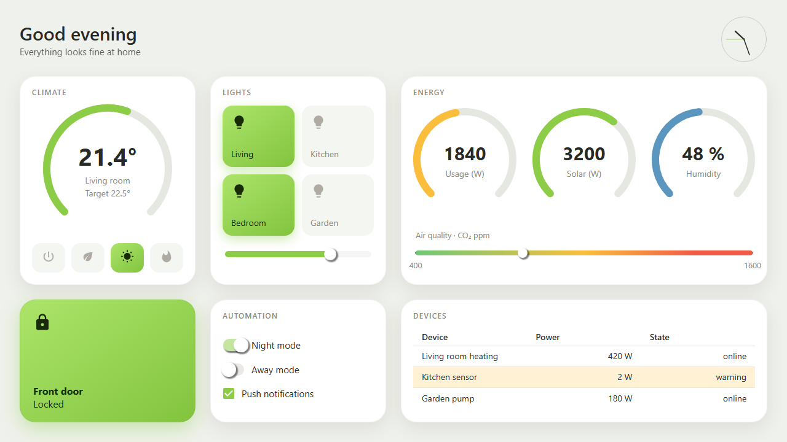 | 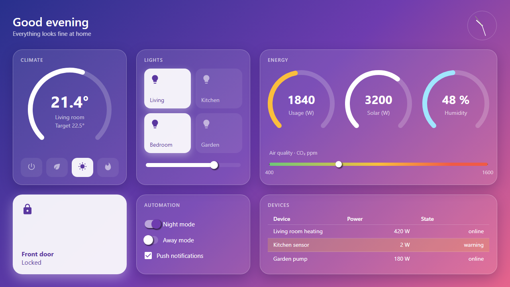 |

### Shapes and styles
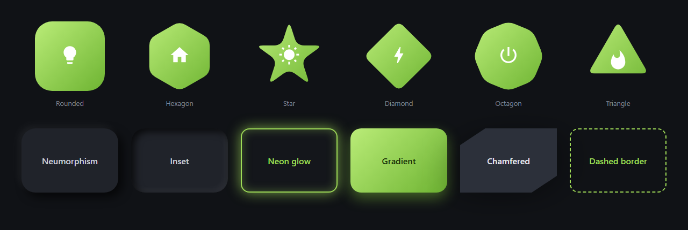

The Universal widget in different shapes (rounded, hexagon, star, diamond, octagon, triangle - or your own polygon) and styles (neumorphism, inset shadows, neon glow, gradients, chamfered corners, dashed borders).

### Data at a glance
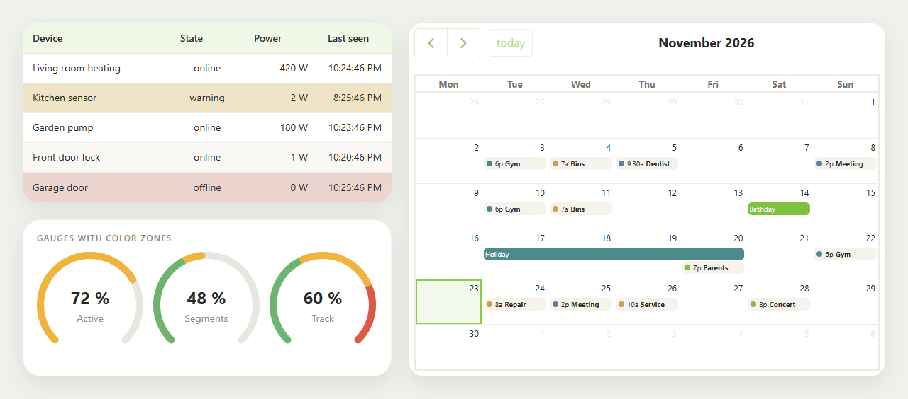

A device table with number and time formats and conditional row colors, gauges with the three color-zone modes, and an event calendar - all fed from plain datapoints.

---

## The widgets at a glance

| Widget | What it does |
|---|---|
| [**Universal**](#universal) | The all-rounder: switch, button, navigation, read-only display, dialog, +/- value, HTTP request, color picker, analog clock |
| [**Slider**](#slider) | Horizontal or vertical slider and bar display, with scale and color zones |
| [**Radial Slider**](#radial-slider) | Circular slider and gauge with scale, needle, second value and color zones |
| [**Switch**](#switch) | Toggle switch with custom values and labels |
| [**Checkbox**](#checkbox) | Checkbox with custom values and labels |
| [**Dropdown**](#dropdown) | Selection list filled from the states of a datapoint, with conditional background |
| [**Table**](#table) | JSON data as a table: formats, sorting, filters, pagination, row colors |
| [**Calendar**](#calendar) | Month calendar as date picker or date display |
| [**Event Calendar**](#event-calendar) | Google-Calendar-style view for appointments (month, week, day, year, lists) |
| [**Marquee**](#marquee) | Scrolling text ticker in any direction |
| [**Value List**](#value-list) | Bullet list from a text or datapoint |

> Every widget page in the [documentation](docs/README.md) lists all settings in detail.

---

## Universal

*The flagship widget.* One tile that reacts to your data and looks different in every state.

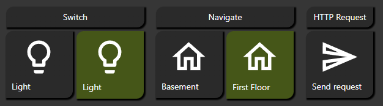

**What happens on click (type)**
- **Switch** toggles a datapoint between two values; **Button** sends a value - optionally only while pressed ("hold") or with automatic reset after a time
- **Navigation** to another view (the active view can be highlighted); **View in dialog** with position, size, title, auto-close and optional control by datapoint
- **Increase / decrease** a number by a step, **HTTP request** or **open URL**
- **Read-only** for pure status tiles
- **Password / PIN protection** for any of the actions above

**What is shown (content)**
- Icon, image, text/HTML with datapoint bindings, an embedded **view**, a full **color picker** (HEX, RGB, HSL, HSV, CIE) or an **analog clock** in several designs
- Content can blink, rotate, mirror and scale

**States and modes**
- Any number of states, chosen by value comparison, each with its own text, icon, colors and shadows
- **Single button** or **separated buttons** (mode selector, radio-button style)
- Click feedback, click-through, content opacity

**Design**
- Shapes: rectangle, triangle, diamond, pentagon, hexagon, heptagon, octagon, star or a **custom polygon**, with rotation and corner radius
- Rounded or chamfered corners, borders, several outer and inner shadows, gradient backgrounds, spacing and alignment

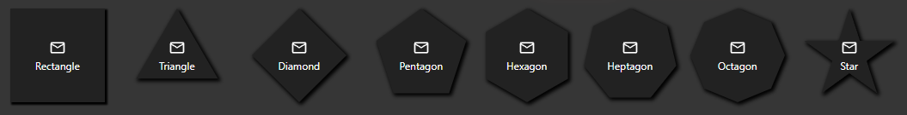

📖 [Universal widget](docs/en/widgets/universal-widget.md) · [Interaction types](docs/en/widgets/universal/interaction-types.md) · [Content types](docs/en/widgets/universal/content-types.md) · [Styling and shapes](docs/en/widgets/universal/styling-and-shapes.md)
· Examples: [hexagon dashboard](docs/example-views/hexagonal-view.md), [rectangle dashboard](docs/example-views/rectangle-view.md), [design examples](docs/universal-widget-design-examples.md)

---

## Slider

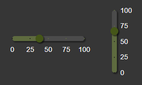

Horizontal or vertical, with min/max, step, scale (automatic or custom marks) and value label. Works as an input or as a **read-only bar display**.

- **Color zones** (e.g. green / yellow / red from a value on) over the active range, as segments, or across the whole track - with hard edges or smooth gradients
- Gradients for rail and active rail, inverted bar, individual track and thumb styling including shadows

📖 [Slider documentation](docs/en/widgets/slider-widget.md)

## Radial Slider

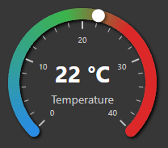

A circular slider that doubles as a **gauge** for temperatures, power, humidity and more.

- Free start and end angle - full circle, three quarters, half circle
- Value in the center with decimals, separator and unit, optional label, **second value** (e.g. target next to actual) and **time of last change**
- **Color zones**, **scale** with ticks and labels, and a **needle**
- Track and thumb styling including shadows; the thumb can be hidden for pure displays

📖 [Radial Slider documentation](docs/en/widgets/radial-slider-widget.md)

## Switch

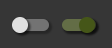

Toggle switch for boolean or any two-state datapoint: own values for on/off, texts per state, label position, and fully styled track and thumb (colors, size, radius, shadows, gradients).

📖 [Switch documentation](docs/en/widgets/switch-widget.md)

## Checkbox

Checkbox with own true/false values, texts per state, label position, and custom box size and colors.

📖 [Checkbox documentation](docs/en/widgets/checkbox-widget.md)

## Dropdown

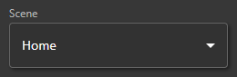

Selection list that takes its options from the states list of the datapoint, or from your own list of values. Optional title, read-only mode, **background color by condition**, and full control over font, colors, border, radius and shadows.

📖 [Dropdown documentation](docs/en/widgets/dropdown-widget.md)

## Table

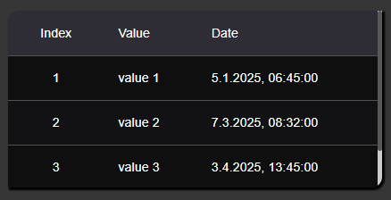

Turns a JSON datapoint into a table.

- Columns with title, width, alignment, prefix/suffix and **formats**: text, number, boolean, date/time, image, link, IP address; calculated columns via formula
- **Sorting** (also multi-column), **column filters**, pagination, sticky header, sum row
- **Row colors by condition** - highlight errors, warnings, thresholds
- Header and row styling, borders, rounded corners, shadows

📖 [Table documentation](docs/en/widgets/table-widget.md)

## Calendar

A month calendar as **date picker**, read-only date display or "today" highlighter. Timestamp or ISO date, past/future lock, week numbers, adjustable day size and full color styling per part (header, weekdays, days, selected day, today).

📖 [Calendar documentation](docs/en/widgets/calendar-widget.md)

## Event Calendar

Google-Calendar-style view of appointments, fed from a JSON datapoint (for example from the **ical** adapter).

- Views: month, week, day, multi-month/year and four list views
- **Several calendars** with own colors and legend, **color rules by title**, week numbers, "+N more" per day
- Every part of the look is configurable

📖 [Event Calendar documentation](docs/en/widgets/event-calendar-widget.md)

## Marquee

Scrolling ticker for long texts and notifications: from a datapoint or fixed text, direction left/right/up/down, speed, gap, pause on hover, background.

📖 [Marquee documentation](docs/en/widgets/marquee-widget.md)

## Value List

Bullet list from a single text value with any separator. Bullet types (disc, circle, square, dash, arrow, numbers, custom character), bullet color, spacing and padding.

📖 [Value List documentation](docs/en/widgets/value-list-widget.md)

---

## Getting started

1. Install the adapter **vis-2-widgets-inventwo** in ioBroker Admin (requires vis 2.0).
2. Open the vis 2 editor and pick a widget from the **inventwo design** list.
3. Select your datapoint and adjust the settings - the preview updates live.
4. To reuse a look, set **From widget** in a style group and pick another widget of the same type.

---

## Migrating from vis-inventwo (vis 1)

Coming from the vis-1 adapter **[vis-inventwo](https://github.com/inventwo/ioBroker.vis-inventwo)**? This adapter includes a migration tool that converts the old widgets (`i-vis-*`) of a project imported into vis 2 to the widgets of this set. You find it in the instance settings of `vis-2-widgets-inventwo` in ioBroker Admin.

It shows a preview first, can write the result into a new project or back up the existing one, and lists everything that should be checked by hand afterwards. Not every widget can be converted completely.

📖 **Migration guide:** [English](docs/en/migration.md) · [Deutsch](docs/de/migration.md)

> **Please note:** The migration was built with care, but there is no guarantee that it works flawlessly for every project - vis-1 projects come in too many different shapes for that. If something is not converted as expected, please [open an issue](https://github.com/inventwo/ioBroker.vis-2-widgets-inventwo/issues). Your feedback helps to improve the tool.

---

## Changelog
<!--
    Placeholder for the next version (at the beginning of the line):
    ### **WORK IN PROGRESS**
-->
### **WORK IN PROGRESS**
- Calendar Widget: the day, today, selected and month/year colors had no effect with the current MUI X version (renamed CSS classes), so the theme text color was used instead; fixed
- Checkbox Widget: true/false values default to `true`/`false` when left empty (like the Switch Widget), so a checkbox without custom values reflects and toggles boolean datapoints
- Universal Widget: no more white border when the border color is left empty (border is now transparent instead of falling back to the text color) (#353)
- Dropdown Widget: the opened list no longer shows a rounded border on iOS (explicit square paper without border/outline) (#350)
- Build: `mf-manifest.json` and `mf-stats.json` are now copied into `widgets/` and thus included in the npm package (fixes 404 errors in the browser) (#349)
- README: new overview with showcase screenshots

### 2.3.0 (2026-11-23)
- Universal Widget: Password/PIN protection is now available for all types that trigger an action (switch, button, view in dialog, increase/decrease, HTTP), not only for navigation
- Universal Widget: Type button can reset the value after a configurable time; the migration assistant takes over the reset time of vis-1
- Slider & Radial Slider: New color zones – the active part changes its color depending on the value (e.g. green/yellow/red), either as a whole, per zone segment or as a fixed scale along the whole track, with a hard cut or a gradient between the zones
- Radial Slider: Decimals, decimal separator and unit for the displayed value; the thumb can be hidden (thumb size 0) to use the widget as a gauge
- Radial Slider: Optional scale ticks with labels, a needle, a second value (e.g. setpoint) and the time of the last change
- Slider: Fixed min/max not being taken over from the object when selecting the object ID
- Universal Widget: Scrolling and pinch-zoom with the finger on touchscreens now also work over the widget; only a button with **Hold value** still blocks touch gestures. A gesture that turns into scrolling no longer triggers the action

### 2.2.0 (2026-11-17)
- Adapter settings: New migration assistant that converts the old vis-1 widgets of the adapter vis-inventwo (`i-vis-*`) in a vis-2 project into the widgets of this adapter – with preview, a list of widgets to check manually and either an automatic backup or a converted copy as new project. It can also restore widgets shown in several views, which vis-2 drops when importing a vis-1 project. Based on the community tool [inventwo-vis1-to-vis2](https://github.com/crunchip77/inventwo-vis1-to-vis2) by crunchip77

### 2.1.1 (2026-11-03)
- Universal Widget: Fixed content color of images not being applied for `rgb()` colors and colors given as hex (`#rgb`, `#rrggbb`, with optional alpha)

### 2.1.0 (2026-11-03)
- Universal Widget: Up to 5 additional inner and outer shadows per widget; X/Y offsets of shadows may now be negative (#286)
- Universal Widget (View in dialog): New option "Set value false on close" – closing the dialog (close button, click outside, timeout) writes "Value false" to the object ID, as long as it still holds "Value true" (#309)

### 2.0.2 (2026-10-17)
- Removed default react 19 border on universal widget

## Older changes
Can be found in [CHANGELOG_OLD.md](CHANGELOG_OLD.md)

---

## License
The MIT License (MIT)

Copyright (c) 2025-2026 jkvarel <jk@inventwo.com>

Permission is hereby granted, free of charge, to any person obtaining a copy
of this software and associated documentation files (the "Software"), to deal
in the Software without restriction, including without limitation the rights
to use, copy, modify, merge, publish, distribute, sublicense, and/or sell
copies of the Software, and to permit persons to whom the Software is
furnished to do so, subject to the following conditions:

The above copyright notice and this permission notice shall be included in
all copies or substantial portions of the Software.

THE SOFTWARE IS PROVIDED "AS IS", WITHOUT WARRANTY OF ANY KIND, EXPRESS OR
IMPLIED, INCLUDING BUT NOT LIMITED TO THE WARRANTIES OF MERCHANTABILITY,
FITNESS FOR A PARTICULAR PURPOSE AND NONINFRINGEMENT. IN NO EVENT SHALL THE
AUTHORS OR COPYRIGHT HOLDERS BE LIABLE FOR ANY CLAIM, DAMAGES OR OTHER
LIABILITY, WHETHER IN AN ACTION OF CONTRACT, TORT OR OTHERWISE, ARISING FROM,
OUT OF OR IN CONNECTION WITH THE SOFTWARE OR THE USE OR OTHER DEALINGS IN
THE SOFTWARE.