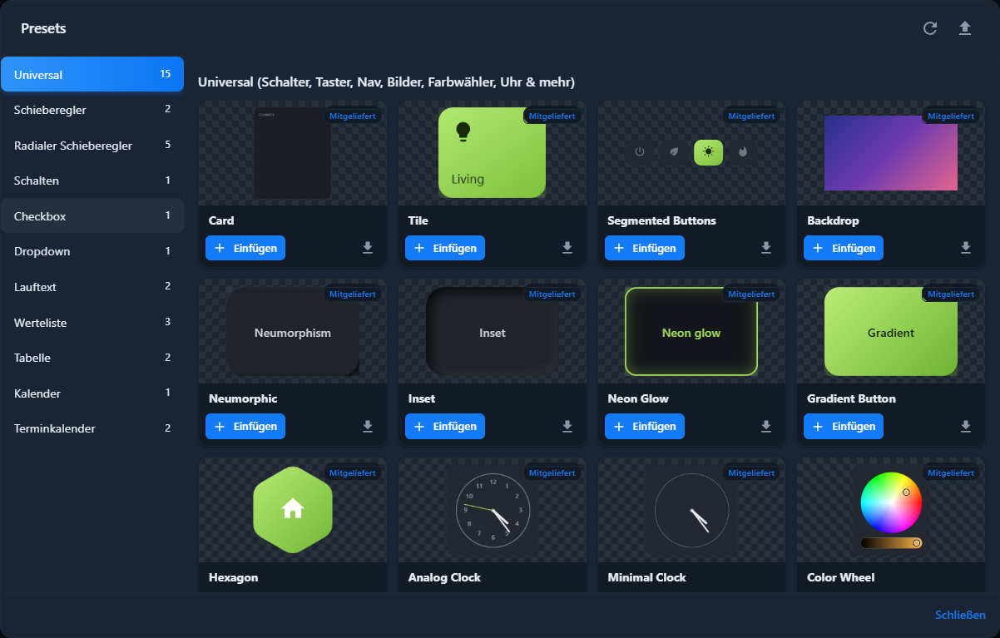

> 🌐 [English](../en/design-presets.md) | **Deutsch**

# Presets

Mit Presets speicherst du das Aussehen eines Widgets einmal und verwendest es bei anderen Widgets wieder — in derselben Ansicht, in anderen Ansichten oder in anderen Projekten. Presets lassen sich außerdem als Datei exportieren und mit anderen Nutzern teilen.

Presets gibt es für **alle inventwo-Widgets**: Universal, Slider, Radial Slider, Switch, Checkbox, Dropdown, Marquee, Value List, Table, Calendar und Terminkalender. Ein Preset gehört immer zu **einem Widget-Typ** und lässt sich nur auf Widgets dieses Typs anwenden (ein Slider-Preset also nicht auf einen Switch).

Ein Preset enthält nur das **Design** eines Widgets, nie seine Funktion oder seinen Inhalt. Datenpunkte (Objekt-IDs), Werte, Texte, Icons, Bilder, Ansichten und Aktionen werden nie übertragen. Was je Widget-Typ zum Design gehört, steht unter [Was wird je Widget übertragen?](#was-wird-je-widget-übertragen).

Presets und [Themes](themes.md) teilen sich die Arbeit: Ein Preset legt die **Form** eines Widgets fest (Aufbau, Größen, Abstände, Schriftgrößen, Form, Winkel, Feedback), ein Theme sein **Aussehen** (Farben, Ecken, Rahmen, Schatten, Schrift). Siehe [Presets auf Theme-gekoppelten Widgets](#presets-auf-theme-gekoppelten-widgets).

---

## Wo zu finden?

Es gibt zwei Stellen:

- **Attributgruppe** — wähle im VIS-2-Editor ein inventwo-Widget aus. Die Gruppe **inventwo - Presets** liegt unter der allgemeinen Gruppe, direkt nach der Gruppe **inventwo - Theme** ([Themes](themes.md)). Hier speicherst, wendest an, kopierst und fügst du das Design der ausgewählten Widgets ein.
- **Paletten-Eintrag** — im Bearbeitungsmodus enthält das inventwo-Widget-Set in der Widget-Palette links den Eintrag **Presets**. Er öffnet eine Galerie mit den Presets aller Widget-Typen (siehe [Preset-Galerie](#preset-galerie)).

---

## Mitgelieferte Presets

Der Adapter bringt für alle Widget-Typen fertige Presets mit, je Form eines, benannt nach der Form: z. B. **Card**, **Tile**, **Segmented Buttons**, **Neumorphic** und **Hexagon** für das Universal Widget, **Thermostat** und **Needle Gauge** für den Radial Slider, **Table** und **Striped Table** für die Tabelle. Farbvarianten gibt es nicht: Die Farben kommen aus einem [Theme](themes.md). Auf ein Widget ohne Theme angewendet, bringt ein mitgeliefertes Preset seine eigenen Farben mit. Sie tragen die Kennzeichnung **Mitgeliefert** und stehen vor deinen eigenen Presets: in der Auswahlliste unter **Mitgelieferte Presets**, danach folgen die **Eigenen Presets**.

- Mitgelieferte Presets lassen sich genau wie eigene **anwenden**, **exportieren** und über die Galerie **in eine Seite einfügen**.
- Sie sind **schreibgeschützt**: Sie können weder gelöscht noch überschrieben werden.
- Ihre Namen sind je Widget-Typ **reserviert** (unabhängig von Groß-/Kleinschreibung). Unter einem solchen Namen lässt sich kein Preset speichern; wähle einen anderen Namen. Beim Import erhält ein Preset mit dem Namen eines mitgelieferten Presets einen Zusatz wie ` (2)`.
- Sie gehören zum Adapter, nicht zur Datei `design-presets.json`, und werden **mit Adapter-Updates aktualisiert**. Möchtest du eine abgewandelte Fassung behalten, wende das mitgelieferte Preset auf ein Widget an, ändere es und speichere es unter einem neuen Namen.
- Können deine eigenen Presets nicht geladen werden (z. B. weil der Dateispeicher nicht erreichbar ist), werden die mitgelieferten Presets trotzdem angezeigt, zusammen mit der Fehlermeldung.

### Vorlagen mit Grundeinstellung
Einige mitgelieferte Presets sind **Vorlagen**: Neben dem Design bringen sie eine passende Grundeinstellung mit, z. B. Typ, Modus, Inhaltsart oder Wertebereich. Datenpunkte, Passwörter, URLs und Ansichten gehören nie dazu; die wählst du danach wie gewohnt aus.

| Widget | Vorlage | Grundeinstellung |
|---|---|---|
| Universal | **Analog Clock**, **Minimal Clock** | Typ „Schreibgeschützt“, Inhalt Analoguhr |
| Universal | **Color Wheel**, **White Tone** | Typ „Schreibgeschützt“, Inhalt Farbwähler (Farbrad bzw. Weißton-Regler), Farbmodell Hex |
| Universal | **Plus/Minus Buttons** | Typ „Wert erhöhen/verringern“, zwei getrennte Schaltflächen −1 / +1 |
| Universal | **Popup Tile** | Typ „Im Dialog anzeigen“, Schließen per Klick außerhalb |
| Universal | **Segmented Buttons** | Getrennte Schaltflächen mit drei Zuständen |
| Slider | **Shutter** | Senkrechter Rollladen-Regler 0–100 |
| Radial Slider | **Thermostat** | 5–30 °C in 0,5er-Schritten |
| Radial Slider | **Half Gauge** | Halbkreis-Anzeige, nur lesen |
| Radial Slider | **Progress Ring** | Fortschrittsring 0–100 %, nur lesen |
| Radial Slider | **Dimmer Ring** | Dimmer 0–100 % |
| Marquee | **Vertical Ticker** | Lauftext von unten nach oben |
| Terminkalender | **Agenda** | Listenansicht der Woche |

- **Einfügen** aus der Galerie legt das Widget mit Design, Grundeinstellung und einer passenden **Startgröße** an.
- **Anwenden** auf ein bestehendes Widget setzt ebenfalls die Grundeinstellung, ändert also z. B. Typ oder Wertebereich. Die Statusmeldung weist darauf hin. Rückgängig machen geht wie gewohnt.
- Der Weißton-Regler von **White Tone** schreibt den Farbwert (Hex) des Weißtons, keine Kelvin-Zahl.
- Eigene Presets enthalten nur das Design, nie eine Grundeinstellung.

---

## Die Attributgruppe

Die Gruppe zeigt eine Auswahlliste **Preset** mit den [mitgelieferten Presets](#mitgelieferte-presets) und allen gespeicherten Presets dieses Widget-Typs, jeweils mit einem kleinen Vorschaubild. Unter der Auswahlliste wird die Vorschau des gewählten Presets angezeigt. Die Aktionen sind kompakte Symbol-Schaltflächen in einer Zeile, durch dünne Trennlinien gruppiert: **Anwenden · Als Preset speichern · Löschen** | **Design kopieren · Design einfügen** | **Importieren · Exportieren · Alle exportieren**. Ist das Attributfenster zu schmal, rückt eine ganze Gruppe in die nächste Zeile. Fahre mit der Maus über eine Schaltfläche, um ihren Namen zu sehen.

| Schaltfläche | Funktion |
|---|---|
| **Anwenden** | Wendet das ausgewählte Preset auf alle ausgewählten Widgets an. |
| **Als Preset speichern** | Fragt nach einem Namen und speichert das Design des ausgewählten Widgets zusammen mit einem Vorschaubild. Gibt es schon ein eigenes Preset mit diesem Namen, wird es nach einer Warnung überschrieben. Namen mitgelieferter Presets sind nicht möglich. |
| **Löschen** | Löscht das ausgewählte Preset (nach Rückfrage). Nur eigene Presets lassen sich löschen. |
| **Design kopieren** | Kopiert das Design des ausgewählten Widgets, ohne ein Preset zu speichern (siehe unten). |
| **Design einfügen** | Fügt das kopierte Design in alle ausgewählten Widgets ein. |
| **Importieren** | Importiert Presets aus einer `.json`-Datei, z. B. aus einem Export oder von einem anderen Nutzer. |
| **Exportieren** | Lädt das ausgewählte Preset als `.json`-Datei herunter. |
| **Alle exportieren** | Lädt alle **eigenen** Presets dieses Widget-Typs als eine `.json`-Datei herunter. Mitgelieferte Presets sind nicht enthalten, da sie ohnehin mit dem Adapter kommen; ein einzelnes mitgeliefertes Preset lässt sich mit **Exportieren** herunterladen. |

### Schnell zwischen Widgets kopieren
Für eine einmalige Übertragung musst du kein Preset speichern:

1. Wähle das Widget aus, dessen Design du kopieren möchtest, und klicke auf **Design kopieren**.
2. Wähle ein oder mehrere Ziel-Widgets desselben Typs aus und klicke auf **Design einfügen**.

Das kopierte Design wird im lokalen Speicher des Browsers abgelegt (eines je Widget-Typ) und steht daher nur in diesem Browser zur Verfügung.

### Presets auf Theme-gekoppelten Widgets
Ist ein Widget an ein [Theme](themes.md) gekoppelt, lassen **Anwenden** und **Design einfügen** alle Felder mit festen Werten aus, die das Theme bei diesem Widget steuert (Farben, Ecken, Rahmen, Schatten; siehe die Token-Tabelle in der Theme-Doku). Das Widget bekommt die Form des Presets und behält das Aussehen seines Themes; eigene Werte in diesen Feldern bleiben, wie sie sind. Die Statusmeldung weist darauf hin. Widgets ohne Theme bekommen das vollständige Design.

Werte, die die CSS-Variablen der Themes nutzen, werden dagegen auch in gekoppelte Widgets übernommen, denn sie wechseln selbst mit dem Theme. Beispiel: Eine Schattenfarbe `color-mix(in srgb, var(--iw-accent) 40%, transparent)` kommt mit dem Preset mit und folgt danach der Akzentfarbe des aktiven Themes.

Speicherst oder kopierst du das Design eines gekoppelten Widgets, kommen leere Theme-Felder nicht als „nicht gesetzt“ ins Preset. Sie zeigen ja den Wert des Themes. Beim Anwenden bleiben diese Felder im Ziel-Widget deshalb unverändert, statt geleert zu werden (z. B. Versatz und Unschärfe des Schattens).

Beim Universal Widget gehören die Theme-Einstellungen **Theme-Hintergrund**, **Aktiver Zustand** und **Beschriftung** zum Preset. Sie werden mit gespeichert und angewendet, auch auf Widgets ohne Theme; dort wirken sie erst, wenn du das Widget koppelst. Die Kopplung selbst (Auswahl des Themes) überträgt ein Preset nie. Sind mehrere Widgets ausgewählt, werden die Theme-Felder bei allen ausgelassen, sobald eines davon gekoppelt ist.

Das Speichern eines Presets und das Einfügen eines Widgets aus der Galerie sind davon nicht betroffen.

### Mehrere Widgets auf einmal
**Anwenden** und **Design einfügen** wirken auf alle aktuell ausgewählten Widgets desselben Typs. Markiere im Editor mehrere Widgets und übertrage das Design in einem Schritt auf alle.

**Als Preset speichern** und **Design kopieren** setzen voraus, dass genau **ein** Widget ausgewählt ist.

### Vorschaubilder
Beim Speichern eines Presets wird ein kleines Bild des Widgets erstellt und mit dem Preset gespeichert. Es zeigt nur das Widget selbst: Der Hintergrund der View und Hintergrund, Rahmen und Schatten aus dem Reiter **CSS** kommen nicht mit aufs Bild, da das Preset sie auch nicht überträgt. Es erscheint in der Auswahlliste, unter der Auswahlliste und in der Galerie. Das Bild dient nur der Orientierung und kann leicht vom echten Widget abweichen:

- Text kann in einer Ersatzschrift dargestellt werden, da Schriftarten nicht eingebettet werden,
- Pseudo-Elemente (`::before`/`::after`) werden nicht erfasst,
- Bilder von anderen Servern können fehlen.

Lässt sich kein Bild erstellen, wird das Preset trotzdem gespeichert — dann ohne Vorschau.

---

## Preset-Galerie

Klicke im Bearbeitungsmodus im inventwo-Widget-Set der Palette auf **Presets**. Es öffnet sich ein Dialog mit den Widget-Typen links (jeweils mit der Anzahl der Presets) und den Presets des gewählten Typs rechts, jeweils als Karte mit Vorschaubild und Name. Die Galerie öffnet sich mit dem zuletzt angesehenen Typ. Mitgelieferte Presets tragen die Kennzeichnung **Mitgeliefert**; bei eigenen Presets steht zusätzlich das Speicherdatum.

| Aktion | Funktion |
|---|---|
| **Einfügen** | Fügt der aktuell ausgewählten Ansicht ein neues Widget vom Typ des Presets hinzu. Es erhält das Design des Presets, bei [Vorlagen](#vorlagen-mit-grundeinstellung) auch deren Grundeinstellung und Startgröße; alle übrigen Attribute bekommen ihre normalen Standardwerte. Datenpunkt, Texte usw. wählst du danach wie gewohnt aus. |
| **Exportieren** (Symbol) | Lädt dieses Preset als `.json`-Datei herunter. |
| **Löschen** (Symbol) | Löscht dieses Preset (nach Rückfrage). Nur bei eigenen Presets vorhanden. |
| **Aktualisieren** (Symbol im Titel) | Lädt die Liste neu, z. B. nachdem in einem anderen Browser-Tab Presets gespeichert wurden. |
| **Importieren** (Symbol im Titel) | Importiert Presets aus einer `.json`-Datei für **alle** darin enthaltenen Widget-Typen, z. B. einen Export mit Presets mehrerer Widget-Typen. Danach zeigt die Galerie den ersten Widget-Typ, für den Presets importiert wurden. |

Neue Presets werden in der Attributgruppe eines Widgets gespeichert.

---

## Was wird je Widget übertragen?

Grundsätzlich gilt: Datenpunkte, Werte, Texte, Icons, Bilder, Ansichten und Aktionen sind **nie** Teil eines Presets. Die Tabellen nennen die Design-Attribute und auffällige Einstellungen, die bewusst nicht übertragen werden.

### Universal Widget
| Wird übernommen | Wird nicht übernommen |
|---|---|
| Farben, Rahmen, Schatten (inkl. zusätzlicher Ebenen), Abstände, Ecken, Form, Ausrichtung, Transparenz, Textstil | Typ, Modus, Anzahl und Werte der Zustände |
| Standardfarben und Zustandsfarben je Zustandsnummer, Inhaltsgröße und Spiegelung je Zustand | Texte, Icons, Bilder |
| Hover- und Klick-Feedback (Farben, Dauer) | Ansichten, Aktionen, Passwörter/PINs |
| Position, Größe, Drehung und Spiegelung des Inhalts, Bildanpassung | Inhaltstyp |
| Aussehen der Analoguhr, des Farbwählers und des Dialogs (Größe, Position, Hintergrund, Titel, Schließen-Taste, Ecken) | Inhalt des Dialogs (Ansicht) |
| Anordnung getrennter Tasten (Richtung, Größe, Abstand) | |

### Slider
| Wird übernommen | Wird nicht übernommen |
|---|---|
| Schiene (Farben, Balkentyp, Breite, Ecken, Schatten) | Min, Max, Schrittweite |
| Regler (Farbe, Größe, Ecken, Schatten) | Die Farbzonen selbst (Anzahl, Ab-Werte, Farben) — ihre Schwellen hängen von Min/Max ab |
| Ausrichtung, Titelabstand, Min/Max-Anzeige, Anzeige des Wert-Labels | Schrittmodus und eigene Schritte |
| Anzeige der Schrittmarken (anzeigen, innen, oben) | Titel, Einheit, Nur lesen |
| Färbungsart und Übergang der Farbzonen | |

### Radial Slider
| Wird übernommen | Wird nicht übernommen |
|---|---|
| Start- und Endwinkel | Min, Max, Schrittweite |
| Schiene und Regler (Farben, Breite/Größe, Schatten) | Skalenintervall |
| Größe und Farbe von Wert und Beschriftung | Die Farbzonen selbst (Anzahl, Ab-Werte, Farben) — ihre Schwellen hängen von Min/Max ab |
| Skala (Striche, Zwischenstriche, Beschriftungen, Farben) und Zeiger | Wertanzeige (Wert anzeigen, Nachkommastellen, Einheit, Beschriftung, zweiter Datenpunkt, letzte Änderung) |
| Färbungsart und Übergang der Farbzonen, Zonenfarbe für den Wert | Nur lesen |

### Switch
| Wird übernommen | Wird nicht übernommen |
|---|---|
| Schiene und Regler (Farben aus/an, Größe, Ecken, Schatten) | Werte für true/false |
| Textposition | Texte |

### Checkbox
| Wird übernommen | Wird nicht übernommen |
|---|---|
| Farbe, aktive Farbe und Größe der Box | Werte für true/false |
| Textposition | Texte |

### Dropdown
| Wird übernommen | Wird nicht übernommen |
|---|---|
| Schriftgröße, Text-, Hintergrund-, Hervorhebungs- und Rahmenfarbe, Rahmenbreite, Ecken | Optionen (States-Liste und eigene Werte) |
| Titelstil (Schriftgröße, Farbe, Innenabstand, Hintergrund aus Bedingung) | Hintergrund-Bedingungen |
| Schatten der Liste und des Widgets | Wert/Text anzeigen, Nur lesen, Titel |

### Marquee
| Wird übernommen | Wird nicht übernommen |
|---|---|
| Richtung, Geschwindigkeit, Textwiederholung, Abstand, Hintergrundfarbe | Text |
| | Pause bei Hover |

### Value List
| Wird übernommen | Wird nicht übernommen |
|---|---|
| Aufzählungszeichen (Typ, eigenes Zeichen, Farbe, Abstand) | Manueller Text, Trennzeichen |
| Zeilenabstand, Innenabstand | Leerzeichen entfernen, leere Einträge ignorieren |

### Table
| Wird übernommen | Wird nicht übernommen |
|---|---|
| Farben von Kopfzeile und Zeilen (gerade/ungerade), Höhen von Kopfzeile, Zeilen und Seitenleiste | Spalten und alle Spalteneinstellungen |
| Linien von Kopfzeile und Zeilen | Bedingungen für Zeilenfarben |
| Ecken, Rahmen, äußerer Schatten | Sortierung, Seitenaufteilung, max. Zeilen, Anzeige von Kopf- und Summenzeile |
| Fixierte Kopfzeile | |

### Calendar
| Wird übernommen | Wird nicht übernommen |
|---|---|
| Farben von Kopfzeile, Wochentagen, Tagen, ausgewähltem Tag, heute und Kalenderwochen | Format, Nur lesen, Vergangenheit/Zukunft sperren |
| Tagesgröße, Ecken, Schatten des ausgewählten Tags | Navigation, erster Wochentag, Anzeige der Kalenderwochen |
| Hervorhebung von heute | |

### Terminkalender
| Wird übernommen | Wird nicht übernommen |
|---|---|
| Kopfzeile (Text und Schaltflächen), Wochentage, Tage, Wochenenden, Kalenderwochen | Farbregeln |
| Heute und Jetzt-Linie | Kalenderquellen und Legende |
| Termine (Farben, Ecken, Schriftgröße), Rahmenlinien | Ansicht, Navigation, erster Wochentag, Anzeige der Kalenderwochen, max. Termine pro Tag |

---

## Gut zu wissen

### „Vom Widget“-Verweise
Nutzt eine Design-Gruppe des Quell-Widgets **Vom Widget** (Stil wird von einem anderen Widget übernommen), speichert das Preset die tatsächlich wirksamen Werte des referenzierten Widgets — das Preset sieht also genau so aus wie das Quell-Widget.

Beim Anwenden eines Presets werden die **Vom Widget**-Verweise der Design-Gruppen am Ziel-Widget entfernt. Sonst würde das referenzierte Widget das Preset weiterhin überschreiben und das neue Aussehen nicht greifen. Bei Zuständen gilt das nur für die Zustandsnummern, für die das Preset Farben enthält; die übrigen Zustände behalten ihren Verweis.

### Bindings werden nicht gespeichert
Werte mit vis-Bindings (z. B. `{...}` in einem Farbfeld) werden nicht ins Preset übernommen, da sie sich auf Datenpunkte beziehen.

### Zustände (Universal Widget)
Zustandsfarben werden je Zustandsnummer gespeichert (Zustand 1, Zustand 2, …). Die Anzahl der Zustände gehört nicht zum Design:

- Hat das Ziel-Widget **weniger** Zustände, kommen keine hinzu. Die Farben der fehlenden Zustände werden trotzdem im Widget gespeichert und greifen, sobald du diese Zustände anlegst.
- Hat das Ziel-Widget **mehr** Zustände, behalten die zusätzlichen Zustände ihre eigenen Farben.

### Reiter „CSS“
Einstellungen aus dem vis-Reiter **CSS** (z. B. Schriftgröße oder Schriftart) sind nicht Teil eines Presets. Übernommen werden nur die inventwo-Attribute.

Der Grund: Die Schnittstelle, die vis-2 für Attributfelder eines Widget-Sets bereitstellt, kann nur die Attribute eines Widgets ändern, nicht seine CSS-Einstellungen. Sie einzubeziehen wäre nur mit Umwegen außerhalb der offiziellen Schnittstelle möglich.

---

## Speicherort und Backup

Presets werden auf dem ioBroker-Server in der Datei `design-presets.json` im Dateispeicher der Instanz `vis-2-widgets-inventwo.0` abgelegt. Das bedeutet:

- sie stehen in **allen Projekten** und für **alle Nutzer** des Editors zur Verfügung,
- sie sind Teil eines normalen ioBroker-Backups.

Mitgelieferte Presets liegen nicht in dieser Datei; sie sind Teil des Adapters.

---

## Export und Import

Die Exportdatei ist eine JSON-Datei (Format-Kennung `inventwo-design-presets`, mit Formatversion) und enthält die Vorschaubilder. Bitte bearbeite sie nicht von Hand.

Beim Import in der Attributgruppe eines Widgets werden nur Presets für diesen Widget-Typ importiert. Der Import in der [Galerie](#preset-galerie) übernimmt die Presets aller unterstützten Widget-Typen; Presets unbekannter Widget-Typen werden übersprungen. In beiden Fällen gilt:
- nur Design-Attribute werden übernommen — alles andere in der Datei wird ignoriert,
- ein Preset mit gleichem Namen wird ersetzt,
- ein Preset mit dem Namen eines mitgelieferten Presets erhält stattdessen einen Zusatz wie ` (2)`,
- Dateien über 1 MB werden abgelehnt, und es werden höchstens 500 Presets pro Datei gelesen,
- Werte mit mehr als 2000 Zeichen werden verworfen,
- Vorschaubilder werden nur als PNG-Data-URLs übernommen.

---

## Siehe auch

- [Universal Widget](widgets/universal-widget.md)
- [Themes](themes.md) — Widgets an ein gemeinsames, per Skript steuerbares Theme koppeln
- [Styling und Formen](widgets/universal/styling-and-shapes.md) — alle Style-Gruppen des Universal Widgets
