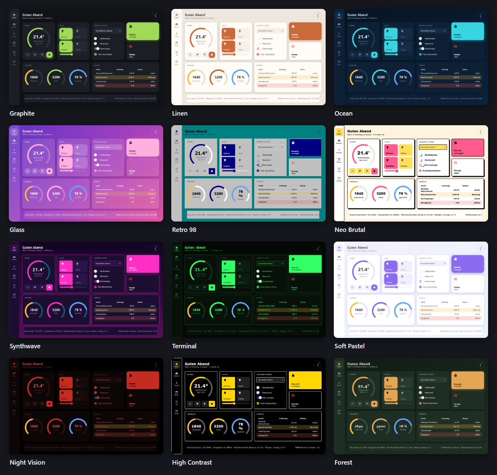
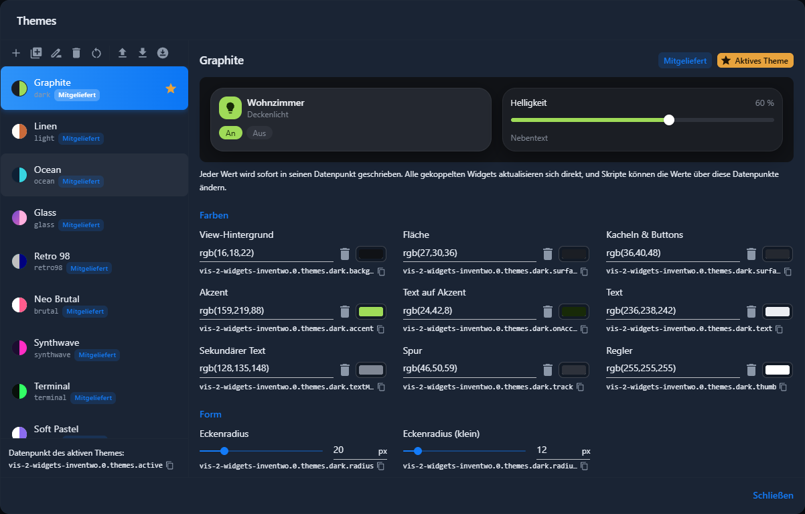
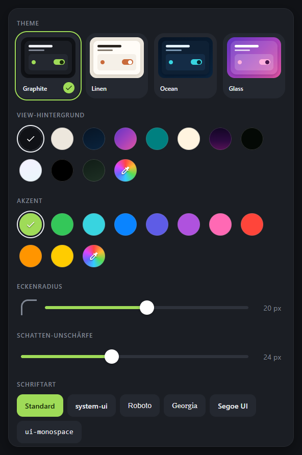

> 🌐 [English](../en/themes.md) | **Deutsch**

# Themes

Ein Theme ist ein benannter Satz von Design-Werten — Farben, Eckenradius, Rahmen, Schatten und Schriftart —, den viele Widgets gemeinsam nutzen. Koppelst du deine Widgets an ein Theme, änderst du das Aussehen des ganzen Dashboards an einer Stelle: von dunkel auf hell wechseln, eine andere Akzentfarbe wählen oder alle Ecken etwas stärker abrunden — jedes gekoppelte Widget folgt sofort, im Editor und auf allen Geräten.

Jeder Wert eines Themes ist ein **ioBroker-Datenpunkt**. Skripte können deshalb das aktive Theme umschalten (z. B. tagsüber ein helles und nachts ein dunkles Theme) oder einzelne Werte ändern (z. B. eine rote Akzentfarbe, solange die Alarmanlage scharf ist).

Themes gibt es für **alle inventwo-Widgets**: Universal, Slider, Radial Slider, Switch, Checkbox, Dropdown, Marquee, Value List, Table, Calendar und Terminkalender.

Themes und [Presets](design-presets.md) ergänzen sich: Ein Preset kopiert die **Form** eines Widgets **einmalig** (Aufbau, Größen, Abstände, Form), ein Theme bleibt **verbunden** und hält das **Aussehen** der Widgets synchron. Auf ein gekoppeltes Widget angewendet, lässt ein Preset die Theme-Felder aus. Schriftgrößen, Größen und Abstände gehören nicht zu einem Theme.

---

## Wo zu finden?

- **Attributgruppe** — wähle im VIS-2-Editor ein inventwo-Widget aus. Die Gruppe **inventwo - Theme** liegt direkt über **inventwo - Presets**. Hier koppelst du die ausgewählten Widgets an ein Theme.
- **Theme-Manager** — im Bearbeitungsmodus enthält das inventwo-Widget-Set in der Widget-Palette links unter **Presets** die Schaltfläche **Themes**. Der Manager lässt sich auch über das Symbol neben der Theme-Auswahl in der Attributgruppe öffnen (siehe [Theme-Manager](#theme-manager)).
- **Widget Theme-Anpassung** — ein Widget für die Laufzeit, z. B. auf einem Wandtablet: Theme wechseln und seine Werte anpassen — Farben, Ecken, Rahmen, Schatten, Schrift (siehe [Widget Theme-Anpassung](#widget-theme-anpassung)).

---

## Mitgelieferte Themes



*Dasselbe Dashboard in allen zwölf mitgelieferten Themes — geändert wurde nur das Theme.*

Der Adapter bringt zwölf Themes mit. Sie werden beim ersten Öffnen des Theme-Managers als Datenpunkte angelegt (wenn noch kein Theme existiert; solange keins existiert, zeigt die Theme-Gruppe dafür den Link **Themes anlegen**); **Graphite** wird zum aktiven Theme.

| ID | Name | Aussehen |
|---|---|---|
| `dark` | Graphite | Dunkel, Akzent in Lindgrün |
| `light` | Linen | Hell und warm, Akzent in Orange |
| `ocean` | Ocean | Dunkelblau, Akzent in Cyan |
| `glass` | Glass | Durchscheinende weiße Flächen auf violettem Verlaufshintergrund |
| `retro98` | Retro 98 | Desktop der späten 90er: graue, erhabene Flächen (Rahmenstil `outset`), Akzent in Marineblau, eckig, petrolfarbener Hintergrund |
| `brutal` | Neo Brutal | Neo-Brutalismus: dicke schwarze Umrisse, harter versetzter Schatten, gelbe Kacheln, Akzent in Pink |
| `synthwave` | Synthwave | 80er-Neon: dunkelvioletter Verlauf, Akzent in Magenta, Regler-Details in Cyan, leuchtende Kanten |
| `terminal` | Terminal | Phosphor-Bildschirm: Grün auf Schwarz, Monospace-Schrift, gestrichelte Umrisse |
| `pastel` | Soft Pastel | Hell und freundlich: Pastell-Flieder, große Ecken, kein Rahmen, weicher Schatten |
| `night` | Night Vision | Für Wandtablets nachts: reines Schwarz, gedimmtes Rot, kein Schatten, blendet nicht |
| `contrast` | High Contrast | Maximale Lesbarkeit, auch aus Entfernung: Schwarz/Weiß, Akzent in Gelb, kräftige weiße Umrisse, kein Schatten |
| `forest` | Forest | Warm und natürlich: tiefes Moosgrün, Akzent in Bernstein, Serifenschrift |

Die Schriften der mitgelieferten Themes sind auf dem Gerät installierte Schriften (z. B. Tahoma, Consolas, Arial Black, Georgia); fehlt eine, nimmt der Browser die nächste Schrift der Liste.

Themes, die in einer neueren Adapter-Version dazukommen, werden nicht automatisch angelegt, wenn schon Themes existieren: Ein Klick auf **Fehlende mitgelieferte Themes wiederherstellen** im Theme-Manager ergänzt sie.

Die mitgelieferten Themes sind ganz normale Themes: Sie lassen sich ändern, umbenennen und löschen. **Fehlende mitgelieferte Themes wiederherstellen** im Theme-Manager legt gelöschte mitgelieferte Themes erneut an (vorhandene Themes bleiben unverändert).

In der Theme-Liste des Theme-Managers tragen mitgelieferte Themes die Kennzeichnung **Mitgeliefert**. Sobald einer ihrer Werte vom Original abweicht, lautet sie **Mitgeliefert · geändert** (der Name zählt nicht), und neben dem Theme-Namen erscheint **Auf Original zurücksetzen**: Nach einer Rückfrage werden alle mitgelieferten Werte zurückgeschrieben, der Name bleibt. Ein Duplikat eines mitgelieferten Themes ist ein eigenes Theme und hat keine Kennzeichnung.

---

## Theme-Werte (Tokens)

Jedes Theme enthält die folgenden Werte. Der Datenpunkt eines Werts ist `vis-2-widgets-inventwo.0.themes.<Theme-ID>.<Token>`, z. B. `vis-2-widgets-inventwo.0.themes.dark.accent`.

| Token | Bezeichnung | Bedeutung | Typ |
|---|---|---|---|
| `background` | View-Hintergrund | Hintergrund der View. Wird nicht auf Widgets angewendet, sondern steht nur als CSS-Variable `--iw-background` bereit (siehe [CSS-Variablen](#css-variablen)). Verläufe erlaubt. | Farbe |
| `surface` | Fläche | Hintergrund von Karten: Tabellenzeilen, Dialoge, Marquee, Universal Widget mit Theme-Hintergrund „Karte“. Verläufe erlaubt. | Farbe |
| `surfaceVariant` | Kacheln & Buttons | Hintergrund von Kacheln und Buttons: Universal Widget (Standard), Dropdown, Tabellenkopf, getrennte Schaltflächen. Verläufe erlaubt. | Farbe |
| `accent` | Akzent | Hervorhebungsfarbe: aktive Slider-Spur und Regler, Switch „an“, angehakte Checkbox, ausgewählter Tag, Termine, Klick-Feedback, aktive getrennte Schaltfläche. Verläufe erlaubt. | Farbe |
| `onAccent` | Text auf Akzent | Text- und Icon-Farbe auf Akzent-Hintergründen. | Farbe |
| `text` | Text | Haupt-Textfarbe; füllt auch die CSS-Textfarbe (`color`) der Widgets. | Farbe |
| `textMuted` | Sekundärer Text | Icons, Beschriftungen, Skalen, Wochentage und andere Nebentexte. | Farbe |
| `track` | Spur | Inaktive Spur von Slidern, Radial Slidern und Switches. | Farbe |
| `thumb` | Regler | Regler (Knopf) des Switches. | Farbe |
| `radius` | Eckenradius | Ecken von Kacheln, Tabellen und Dialogen. | Zahl (px), 0–100 |
| `radiusSmall` | Eckenradius (klein) | Ecken kleiner Elemente: Dropdown, Schaltflächen und Termine des Terminkalenders. | Zahl (px), 0–100 |
| `border` | Rahmenfarbe | Farbe von Rahmen und Linien. | Farbe |
| `borderWidth` | Rahmenbreite | Breite des Rahmens von Kacheln, Tabellen und Dropdown. | Zahl (px), 0–20 |
| `borderStyle` | Rahmenstil | `none`, `solid`, `dashed`, `dotted`, `double`, `groove`, `ridge`, `inset` oder `outset` (die letzten vier zeichnen aus der Rahmenfarbe eine 3D-Kante). | Text |
| `shadow` | Schattenfarbe | Farbe aller Schatten. | Farbe |
| `shadowX` | Schatten X-Versatz | Horizontaler Versatz des äußeren Schattens. | Zahl (px), −50–50 |
| `shadowY` | Schatten Y-Versatz | Vertikaler Versatz des äußeren Schattens. | Zahl (px), −50–50 |
| `shadowBlur` | Schatten-Unschärfe | Unschärfe des äußeren Schattens. | Zahl (px), 0–100 |
| `shadowSize` | Schatten-Ausdehnung | Ausdehnung des äußeren Schattens. | Zahl (px), −50–50 |
| `fontFamily` | Schriftart | CSS-Schriftart, z. B. `Inter, sans-serif`. Leer = Schrift der View. | Text |

Farben akzeptieren jeden CSS-Farbwert (`#ff9800`, `rgb(...)`, `rgba(...)`, ...).

---

## Widget koppeln

1. Wähle im Editor ein oder mehrere inventwo-Widgets aus.
2. Wähle in der Gruppe **inventwo - Theme** in der Auswahl **Theme** ein Theme:
   - **Kein Theme** — das Widget ist nicht gekoppelt (Standard).
   - **Aktives Theme** — das Widget folgt dem gerade aktiven Theme. Wird das aktive Theme gewechselt (im Manager, über das Widget Theme-Anpassung oder per Skript), ändert sich auch das Widget. Das ist die übliche Wahl.
   - **Ein bestimmtes Theme** (z. B. Ocean) — das Widget verwendet immer dieses Theme, unabhängig vom aktiven Theme.

### Eigener Wert gewinnt
Ein Theme füllt nur Design-Felder, die **leer** sind. Ein Feld mit eigenem Wert behält diesen. So kannst du ein Widget koppeln und ihm trotzdem z. B. eine eigene Hintergrundfarbe geben.

Beim Koppeln werden die Felder, die das Theme steuert, **geleert**, damit das Theme wirkt. Unter der Auswahl zeigt die Gruppe, wie viele Design-Felder vom Theme gesteuert werden (z. B. „12 von 14 Feldern folgen dem Theme“). Hast du danach eigene Werte eingetragen, leert **Eigene Werte zurücksetzen** sie wieder, sodass alle Felder dem Theme folgen.

### Entkoppeln behält das Aussehen
Stellst du die Auswahl zurück auf **Kein Theme**, werden die aktuellen Theme-Werte in die leeren Felder geschrieben. Das Widget behält sein Aussehen und lässt sich ab dann frei bearbeiten.

### Universal Widget: Theme-Hintergrund
Beim Universal Widget hat die Gruppe zusätzlich die Einstellung **Theme-Hintergrund**:

| Option | Hintergrund des Widgets |
|---|---|
| **Kachel** (Standard) | Theme-Wert **Kacheln & Buttons** |
| **Karte** | Theme-Wert **Fläche** |
| **Keiner (eigener Hintergrund)** | Das Theme setzt keinen Hintergrund; das Widget behält seinen eigenen (z. B. eine transparente Icon-Schaltfläche) |

Zustände des Universal Widgets: Im Modus **Getrennte Tasten** verwenden inaktive Schaltflächen **Kacheln & Buttons** und **Sekundärer Text**, die aktive Schaltfläche **Akzent** und **Text auf Akzent**. Eine einzelne Schaltfläche mit einem Zustand verwendet **Akzent** und **Text auf Akzent**. Widgets mit mehreren Zuständen behalten ihre eigenen Zustandsfarben.

### Was das Theme je Widget steuert

| Widget | Gesteuerte Design-Felder |
|---|---|
| Universal | Hintergrund, Inhalts- und Textfarbe, Rahmen (Farbe, Breite, Stil), Ecken, äußerer Schatten, Klick-Feedback, Dialog (Hintergrund, Titel, Schließen-Schaltfläche, Ecken), Farben der Analoguhr, Zustände (siehe oben) |
| Slider | Spur, aktive Spur, Regler, Schattenfarben |
| Radial Slider | Spur, aktive Spur, Regler, Schattenfarben, Farben von Wert, Zeiger, Beschriftung und Skala |
| Switch | Spur aus/an, Regler, Schattenfarben |
| Checkbox | Box-Farbe, aktive Farbe |
| Dropdown | Text, Hintergrund, Hervorhebung, Rahmen (Farbe, Breite), Ecken, Titelfarbe, Schattenfarben |
| Marquee | Hintergrund |
| Value List | Aufzählungszeichen-Farbe |
| Table | Hintergründe von Kopf und Zeilen, Linien und Rahmen, Ecken, äußerer Schatten |
| Calendar | Farben von Kopfzeile, Wochentagen, Tagen, heute, ausgewähltem Tag, Kalenderwochen und Hover, Schatten des ausgewählten Tags |
| Terminkalender | Kopfzeile und Kopf-Schaltflächen, Tage, heute, Termine, Rahmen, Ecken, Nebentexte |

Außerdem füllt das Theme die Textfarbe (`color`) und — wenn das Theme eine Schriftart hat — die Schriftart in den CSS-Einstellungen jedes gekoppelten Widgets, solange diese leer sind.

### „Vom Widget“-Verweise
Nutzt eine Design-Gruppe **Vom Widget** und ist das referenzierte Widget an ein Theme gekoppelt, werden dessen leere Felder ebenfalls aus seinem Theme gefüllt.

---

## Theme-Manager



Du öffnest ihn über **Themes** im inventwo-Widget-Set der Palette (Bearbeitungsmodus) oder über das Symbol neben der Theme-Auswahl in der Attributgruppe. Der Dialog zeigt links die Themes (mit Farbmuster; das aktive Theme ist mit einem Stern markiert) und rechts die Werte des ausgewählten Themes, gruppiert in **Farben**, **Form**, **Rahmen**, **Schatten** und **Schrift**, zusammen mit einer Live-Vorschau.

| Aktion | Was sie tut |
|---|---|
| **Neues Theme** | Legt ein neues Theme mit den Werten des Standard-Themes an. |
| **Theme duplizieren** | Legt eine Kopie des ausgewählten Themes an (Name „… (Kopie)“). |
| **Theme umbenennen** | Ändert den Anzeigenamen. Die ID (und damit die Datenpunkte) bleibt gleich. |
| **Theme löschen** | Löscht das Theme (nach Rückfrage). Seine Datenpunkte bleiben als gelöscht markiert im Objektbaum und werden wiederverwendet, wenn erneut ein Theme mit derselben ID angelegt wird; im Admin lassen sie sich entfernen. An dieses Theme gekoppelte Widgets verwenden dann ihre eigenen Werte. War es das aktive Theme, wird ein anderes Theme aktiv. |
| **Fehlende mitgelieferte Themes wiederherstellen** | Legt gelöschte mitgelieferte Themes erneut an. |
| **Themes importieren** | Legt die Themes einer exportierten Datei als neue Themes an (siehe [Themes exportieren und importieren](#themes-exportieren-und-importieren)). |
| **Theme exportieren** | Speichert das ausgewählte Theme als JSON-Datei. |
| **Alle Themes exportieren** | Speichert alle Themes in einer JSON-Datei. |
| **Als aktiv setzen** | Macht das ausgewählte Theme zum aktiven Theme für alle Geräte. |

Jede Änderung wird **sofort** in ihren Datenpunkt geschrieben; alle gekoppelten Widgets aktualisieren sich direkt. Die ID jedes Datenpunkts lässt sich über das Kopier-Symbol kopieren, z. B. für ein Skript.

Die ID eines neuen Themes wird aus seinem Namen gebildet (Kleinbuchstaben, Ziffern und `_`), z. B. wird aus „Mein Theme“ `mein_theme`.

### Themes exportieren und importieren

Themes lassen sich als Datei speichern und weitergeben, z. B. um ein Theme mit anderen Nutzern zu teilen oder es in eine andere ioBroker-Installation zu übernehmen. Die Schaltflächen liegen in der Werkzeugleiste über der Theme-Liste, hinter dem Trennstrich:

- **Themes importieren** — öffnet einen Dateidialog; wähle eine zuvor exportierte `.json`-Datei. Eine Datei kann ein oder mehrere Themes enthalten.
- **Theme exportieren** — lädt das ausgewählte Theme als `<Name>.json` herunter.
- **Alle Themes exportieren** — lädt alle Themes in einer Datei `inventwo-themes.json` herunter.

Die Datei ist reines JSON mit Name, ID und allen [Theme-Werten](#theme-werte-tokens) jedes Themes. Beim Import werden **immer neue Themes angelegt** — vorhandene Themes werden nie überschrieben. Gibt es bereits ein Theme mit derselben ID oder demselben Namen, wird das importierte Theme umbenannt (z. B. „Ocean (2)“) und bekommt eine eigene ID. Ungültige Werte in der Datei werden ignoriert (stattdessen gilt der Standardwert); pro Datei werden höchstens 50 Themes importiert. Nach dem Import ist das erste importierte Theme ausgewählt.

---

## Datenpunkte und Skripte

| Datenpunkt | Inhalt |
|---|---|
| `vis-2-widgets-inventwo.0.themes` | Ordner aller Themes |
| `vis-2-widgets-inventwo.0.themes.active` | ID des aktiven Themes (z. B. `dark`), beschreibbar. Leer = kein aktives Theme |
| `vis-2-widgets-inventwo.0.themes.<id>` | Kanal eines Themes; sein Name ist der Anzeigename |
| `vis-2-widgets-inventwo.0.themes.<id>.<token>` | Ein Datenpunkt je [Theme-Wert](#theme-werte-tokens): Text für Farben, Rahmenstil und Schriftart, Zahl (px) für die Zahlenwerte |

Änderungen dieser Datenpunkte kommen sofort in den geöffneten Views an — ohne vis-Bindungen. Ungültige Werte (z. B. Text in einem Zahlen-Datenpunkt oder ein unbekannter Rahmenstil) werden ignoriert; die Widgets verwenden dann den Standardwert dieses Tokens.

### Beispiel: tagsüber hell, nachts dunkel (JavaScript-Adapter)

```javascript
// 07:00: helles Theme
schedule('0 7 * * *', () => {
    setState('vis-2-widgets-inventwo.0.themes.active', 'light');
});

// 22:00: dunkles Theme
schedule('0 22 * * *', () => {
    setState('vis-2-widgets-inventwo.0.themes.active', 'dark');
});
```

Mit Astrozeiten statt fester Uhrzeiten: `schedule({ astro: 'sunrise' }, ...)` und `schedule({ astro: 'sunset' }, ...)`.

### Beispiel: Akzentfarbe ändern

```javascript
// Roter Akzent, solange die Alarmanlage scharf ist, sonst Lindgrün
on({ id: 'alarm.0.armed', change: 'ne' }, obj => {
    setState('vis-2-widgets-inventwo.0.themes.dark.accent', obj.state.val ? 'rgb(255,69,58)' : 'rgb(159,219,88)');
});
```

Zahlenwerte werden als Zahl geschrieben, z. B. `setState('vis-2-widgets-inventwo.0.themes.dark.radius', 8);`.

> **Hinweis:** Ein Gerät, auf dem das aktive Theme mit **Nur dieses Gerät** gewählt wurde (siehe [Widget Theme-Anpassung](#widget-theme-anpassung)), behält seine eigene Wahl und folgt `themes.active` erst wieder, wenn die Einstellung zurückgestellt wird.

---

## CSS-Variablen

Die Werte des aktiven Themes stehen in jeder View auch als CSS-Variablen bereit. Du kannst sie überall verwenden, wo CSS möglich ist. Auch andere Widgets (auch aus anderen Widget-Sets) können die Variablen in ihren CSS-Feldern nutzen, z. B. `color: var(--iw-text)`.

### View-Hintergrund mit dem Theme wechseln

Der Hintergrund der View gehört zur View, nicht zu einem Widget. Damit er mit dem Theme wechselt, trägst du die Variable `--iw-background` in den Einstellungen der View ein:

1. Klicke im Editor auf eine leere Stelle der View, sodass kein Widget ausgewählt ist.
2. Öffne rechts im Attributfenster den Reiter **Seite** und darin die Gruppe **CSS-Hintergrund (background-...)**.
3. Lass **Bild** und **Hintergrundklasse** leer. Nur dann wird die Checkbox **Ein Parameter** angezeigt.
4. Setze den Haken bei **Ein Parameter**. Die Einzelfelder (`-color`, `-image`, `-repeat` …) verschwinden, stattdessen erscheint das Feld **background**.
5. Trage im Feld **background** `var(--iw-background)` ein.

Ohne den Haken gibt es nur das Feld `-color` (`background-color`). Das reicht nicht: Einige Themes (z. B. Glass, Synthwave, Forest) haben einen Farbverlauf als Hintergrund, und den kann nur `background` darstellen.

Das gilt je View: Jede View, deren Hintergrund mitwechseln soll, braucht diesen Eintrag.

| Variable | Token |
|---|---|
| `--iw-background` | View-Hintergrund |
| `--iw-surface` | Fläche |
| `--iw-surface-variant` | Kacheln & Buttons |
| `--iw-accent` | Akzent |
| `--iw-on-accent` | Text auf Akzent |
| `--iw-text` | Text |
| `--iw-text-muted` | Sekundärer Text |
| `--iw-track` | Spur |
| `--iw-thumb` | Regler |
| `--iw-radius` | Eckenradius (mit `px`) |
| `--iw-radius-small` | Eckenradius (klein) (mit `px`) |
| `--iw-border` | Rahmenfarbe |
| `--iw-border-width` | Rahmenbreite (mit `px`) |
| `--iw-border-style` | Rahmenstil |
| `--iw-shadow` | Schattenfarbe |
| `--iw-shadow-x` | Schatten X-Versatz (mit `px`) |
| `--iw-shadow-y` | Schatten Y-Versatz (mit `px`) |
| `--iw-shadow-blur` | Schatten-Unschärfe (mit `px`) |
| `--iw-shadow-size` | Schatten-Ausdehnung (mit `px`) |
| `--iw-font-family` | Schriftart (`inherit`, wenn leer) |

Die Variablen werden gesetzt, sobald in der View ein inventwo-Widget geladen wurde und ein Theme aktiv ist.

---

## Widget Theme-Anpassung



Mit dem Widget **Theme-Anpassung** (Theme Customizer) können Nutzer das Theme zur Laufzeit ändern, z. B. auf einem Wandtablet. Es ist selbst im aktiven Theme gestaltet und zeigt:

- **Theme** — eine Karte je Theme mit kleiner Vorschau; ein Tipp auf eine Karte macht dieses Theme aktiv.
- **Theme-Werte** — jeder Wert des Theme-Managers lässt sich zuschalten: Farben als Chips mit eigenen Vorschlägen und Farbwähler, Zahlen als Schieberegler, Rahmenstil und Schriftart als Knöpfe. Akzentfarbe und Eckenradius sind standardmäßig sichtbar.

Im Bearbeitungsmodus zeigt das Widget seinen Inhalt, ändert aber nichts.

| Einstellung | Was sie tut |
|---|---|
| **Titel** | Optionaler Titel über den Bereichen. |
| **Änderungen gelten für** | **Alle Geräte** (Standard): Das aktive Theme wird in den Datenpunkt `themes.active` geschrieben. **Nur dieses Gerät**: Die Auswahl wird im Browser dieses Geräts gespeichert und überschreibt dort das globale Theme. **Auswahl durch Nutzer**: Das Widget zeigt einen Schalter **Nur dieses Gerät**, der Nutzer entscheidet selbst. |
| **Themes anzeigen** | Zeigt die Theme-Karten. |
| **Theme-Filter** | Auswahlliste mit allen Themes, mehrere ankreuzbar. Keine Auswahl = alle Themes. |
| **Farbwähler anbieten** | Ergänzt jede Farbe um einen Knopf mit Farbwähler. |
| **Customizer-Gruppen** | Je Theme-Wert eine Checkbox (Farben, Form, Rahmen, Schatten, Schrift); Farben und Schriftarten nehmen eigene Vorschläge. Siehe [Widget Theme-Anpassung](widgets/theme-customizer-widget.md#customizer-gruppen). |
| **Theme-Layout** | **Raster** (Karten umbrechen auf mehrere Zeilen) oder **Zeile (scrollbar)**. |
| **Kartengröße** | Breite der Theme-Karten (80–260 px). |

> **Theme-Werte gelten immer für alle Geräte:** Sie ändern die Werte des Themes selbst (seine Datenpunkte), nicht nur die Auswahl auf diesem Gerät.

Zum Schreiben der Datenpunkte braucht der vis-Benutzer Schreibrechte; kann eine Änderung nicht gespeichert werden, zeigt das Widget eine kurze Meldung.

→ [Widget Theme-Anpassung](widgets/theme-customizer-widget.md)

---

## Speicherort und Backup

Themes werden als Datenpunkte unter `vis-2-widgets-inventwo.0.themes` gespeichert. Sie stehen damit in **allen Projekten** und auf **allen Geräten** zur Verfügung und sind Teil eines normalen ioBroker-Backups. Jeder Browser hält zusätzlich eine Kopie der Themes im lokalen Speicher, damit die Widgets schon beim Laden der View die richtigen Farben zeigen.

---

## Siehe auch

- [Presets](design-presets.md) — ein komplettes Design zwischen Widgets kopieren
- [Widget Theme-Anpassung](widgets/theme-customizer-widget.md)
- [Styling und Formen](widgets/universal/styling-and-shapes.md) — alle Stil-Gruppen des Universal Widgets
