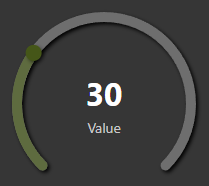

> 🌐 [English](../../en/widgets/radial-slider-widget.md) | **Deutsch**

# Radial Slider Widget

Das Radial Slider Widget ist ein kreisförmiger Bogenschieberegler für numerische Datenpunkte. Es funktioniert wie das normale Slider Widget, aber der Benutzer zieht entlang einer kreisförmigen Bahn statt einer geraden Linie. Es eignet sich perfekt für Thermostat-Kacheln, Lautstärkeknöpfe oder jede Steuerung, bei der ein rundes Drehregler-Element zum Design passt.

---

## Widget hinzufügen

1. Ziehe **Radial Slider** aus der Widget-Liste **inventwo design** auf deine Ansicht.
2. Passe die Größe des Widgets an — es wird als Quadrat gerendert; die Widget-Größe bestimmt die Reglergröße.
3. Klicke auf **Objekt-ID** und wähle deinen numerischen Datenpunkt. Min, Max und Step werden automatisch aus der Objektdefinition übernommen.
4. Passe **Startwinkel** und **Endwinkel** an, um die Bogenform zu definieren.
5. Gestalte Schiene und Regler in den Gruppen **inventwo - Radial track** und **inventwo - Radial thumb**.

---

## Einstellungen

### Common

| Einstellung | Beschreibung |
|-------------|--------------|
| **Objekt-ID** | Der Datenpunkt zum Lesen und Schreiben. Min, Max und Step werden bei der Auswahl einer OID automatisch aus der Objektdefinition befüllt. |
| **Mindestwert** | Der Wert am Anfang des Bogens. Standard: 0. |
| **Maximalwert** | Der Wert am Ende des Bogens. Standard: 100. |
| **Schritt** | Um wie viel sich der Wert pro Schritt ändert. Standard: 1. |
| **Startwinkel** | Der Winkel (0–360°), an dem der Bogen beginnt. 0° ist oben, Winkel steigen im Uhrzeigersinn. Standard: 225 (unten links). |
| **Endwinkel** | Der Winkel (0–360°), an dem der Bogen endet. Standard: 135 (unten rechts). Zusammen mit dem Standard-Startwinkel ergibt das die klassische "270°-Drehregler"-Form. |
| **Wert anzeigen** | Zeigt den aktuellen numerischen Wert in der Mitte des Reglers an. |
| **Dezimalstellen** | *(Nur bei Wert anzeigen)* Anzahl der Nachkommastellen des angezeigten Werts. Leer lassen, um den Wert unverändert anzuzeigen. |
| **Dezimaltrennzeichen** | *(Nur bei Wert anzeigen)* Zeichen für die Dezimaltrennung, z. B. `,`. Leer lassen für `.`. |
| **Einheit** | *(Nur bei Wert anzeigen)* Text, der direkt an den angezeigten Wert angehängt wird, z. B. `°C` oder ` %`. |
| **Bezeichnung anzeigen** | Zeigt eine Textbeschriftung unterhalb des Werts in der Mitte an. Nur sichtbar, wenn ein Beschriftungstext eingegeben wurde. |
| **Bezeichnung** | Der Text, der als Mittelbeschriftung angezeigt wird, z. B. `°C` oder `%`. Nur sichtbar, wenn **Bezeichnung anzeigen** aktiviert ist. |
| **Zweitwert (Objekt-ID)** | Optionaler zweiter Datenpunkt, der unter Wert/Bezeichnung angezeigt wird, z. B. der Sollwert neben dem Istwert. Zahlen verwenden dieselben Dezimalstellen und dasselbe Dezimaltrennzeichen wie der Hauptwert. |
| **Präfix Zweitwert** | *(Nur mit Zweitwert)* Text vor dem Zweitwert, z. B. `Soll: `. |
| **Einheit Zweitwert** | *(Nur mit Zweitwert)* Text, der an den Zweitwert angehängt wird, z. B. `°C`. |
| **Letzte Änderung anzeigen** | Zeigt unter Wert/Bezeichnung an, wann sich der Wert des Datenpunkts zuletzt geändert hat. |
| **Format letzte Änderung** | *(Nur bei Letzte Änderung anzeigen)* Formatmuster, z. B. `DD.MM. hh:mm`. Es gelten dieselben Tokens wie im Table Widget (`YYYY`, `MM`, `DD`, `hh`, `mm`, `ss`, `WD`, …). |
| **Schreibgeschützt** | Bei Aktivierung zeigt der Regler den aktuellen Wert an, kann aber nicht gezogen werden. Nützlich für reine Anzeige-Regler. |

---

### Farbzonen

Farbzonen ändern die Farbe des aktiven Bereichs abhängig vom aktuellen Wert — z. B. grün, gelb und rot für eine Temperatur oder einen Füllstand.

| Einstellung | Beschreibung |
|-------------|--------------|
| **Anzahl Farbzonen** | Wie viele Zonen unten konfiguriert werden. **0** schaltet die Farbzonen ab. |
| **Einfärbung** | **Ganzer aktiver Bereich** (Standard): der aktive Bereich hat komplett die Farbe der Zone, in der der aktuelle Wert liegt. **Nur Segmente der Zonen**: jede Zone färbt nur ihren eigenen Abschnitt des aktiven Bereichs, alle bereits durchlaufenen Zonen bleiben also sichtbar. **Ganze Schiene (Skala)**: die Zonen sind immer über die ganze Schiene sichtbar, unabhängig vom Wert; der aktive Bereich wird nicht gezeichnet, den Wert zeigt der Regler oder der Zeiger. |
| **Übergang zwischen Zonen** | *(Nicht bei Ganzer aktiver Bereich)* **Harter Schnitt**: die Farbe wechselt abrupt an jedem Zonenstart. **Verlauf**: die Farben gehen ineinander über; jede Zone hat an ihrem Startwert genau ihre Farbe. |
| **Zonenfarbe auch für den Wert verwenden** | Färbt auch den Wert in der Mitte in der Zonenfarbe (nicht bei Gradient-Strings). |
| **Ab Wert** *(pro Zone)* | Die Zone gilt ab diesem Wert bis zum Startwert der nächsthöheren Zone. |
| **Farbe** *(pro Zone)* | Farbe des aktiven Bereichs, solange der Wert in dieser Zone liegt. Gradient-Strings werden unterstützt. |

Es gewinnt die Zone mit dem höchsten **Ab Wert**, der nicht über dem aktuellen Wert liegt; die Reihenfolge der Zonen spielt also keine Rolle. Unterhalb der niedrigsten Zone gilt die normale aktive Farbe.

In den Modi **Nur Segmente der Zonen** und **Ganze Schiene (Skala)** können keine Gradient-Strings als Zonenfarbe verwendet werden; solche Zonen werden übersprungen. Unterhalb der niedrigsten Zone hat das Segment die normale aktive Farbe.

**Beispiel:** Zonen ab `0` (grün), `60` (gelb) und `85` (rot) zeigen bis 59 grün, von 60 bis 84 gelb und ab 85 rot.

---

### inventwo - Radialer Track

| Einstellung | Beschreibung |
|-------------|--------------|
| **Vom Widget** | Alle Track-Einstellungen von einem anderen Radial Slider Widget kopieren. |
| **Spurfarbe** | Farbe des Hintergrundbogens (der vollständige Bogen, der noch nicht erreicht wurde). Unterstützt Gradient-Strings, z. B. `linear-gradient(90deg, #aaa, #444)`. |
| **Track aktive Farbe** | Farbe des gefüllten Bogens (der Teil vom Start bis zum aktuellen Wert). Unterstützt ebenfalls Gradient-Strings. |
| **Spurbreite** | Dicke des Bogens in Pixeln. Standard: 10. |
| **Spurleiste Schatten** | Schlagschatten auf dem Hintergrundbogen. X-Offset, Y-Offset, Unschärfe und Farbe einstellen. |

---

### inventwo - Radialer Daumen

| Einstellung | Beschreibung |
|-------------|--------------|
| **Vom Widget** | Alle Thumb-Einstellungen von einem anderen Radial Slider Widget kopieren. |
| **Daumenfarbe** | Farbe des kreisförmigen Reglers. |
| **Daumengröße** | Durchmesser des Regler-Kreises in Pixeln (0–50). Standard: 16. Auf 0 setzen, um den Regler vollständig auszublenden (z. B. für eine reine Anzeige). |
| **Regler Schatten** | Schlagschatten auf dem Regler. |

---

### inventwo - Radialer Wert

| Einstellung | Beschreibung |
|-------------|--------------|
| **Wertgröße** | Schriftgröße des mittleren Werts in Pixeln (8–100). Standard: 32. |
| **Wertfarbe** | Farbe des mittleren Werttexts. |
| **Bezeichnungsgröße** | Schriftgröße der mittleren Beschriftung in Pixeln (8–50). Standard: 14. |
| **Bezeichnungsfarbe** | Farbe des mittleren Beschriftungstexts. |

---

### inventwo - Radiale Skala & Zeiger

Macht aus dem Regler eine klassische Anzeige: Skalenstriche an der Innenseite des Bogens und ein Zeiger von der Mitte zum aktuellen Wert.

| Einstellung | Beschreibung |
|-------------|--------------|
| **Skalenstriche anzeigen** | Zeichnet Striche entlang der Innenseite der Schiene. |
| **Abstand der Hauptstriche** | Wertabstand zwischen zwei Hauptstrichen, z. B. `10`. Leer lassen für zehn gleichmäßige Abschnitte. |
| **Zwischenstriche pro Abschnitt** | Anzahl kürzerer Striche zwischen zwei Hauptstrichen (0–9). |
| **Strichlänge / Strichstärke** | Länge und Dicke der Hauptstriche in Pixeln. Zwischenstriche werden kürzer und dünner gezeichnet. |
| **Farbe der Skalenstriche** | Farbe der Striche. |
| **Skalenbeschriftung** | **Keine**, **Nur Min/Max** oder **Alle Hauptstriche**. Die Beschriftung verwendet Dezimalstellen und Dezimaltrennzeichen des Werts, ohne Einheit. |
| **Schriftgröße / Farbe Skalenbeschriftung** | Aussehen der Skalenbeschriftung. |
| **Zeiger anzeigen** | Zeichnet einen Zeiger von der Mitte zum aktuellen Wert. Am besten mit ausgeschaltetem **Wert anzeigen** oder kleiner Wertgröße kombinieren, da der Zeiger durch die Mitte läuft. |
| **Zeigerfarbe / Zeigerstärke** | Aussehen des Zeigers. |
| **Zeigerlänge (%)** | Länge des Zeigers relativ zum Bogenradius. |
| **Größe der Zeigerachse** | Durchmesser der runden Achse in der Mitte. 0 blendet sie aus. |

---

## Winkel verstehen

Die Winkel werden im Uhrzeigersinn von oben gemessen (12-Uhr-Position = 0°).

| Winkel | Position auf dem Regler |
|--------|------------------------|
| 0° | Oben (12 Uhr) |
| 90° | Rechts (3 Uhr) |
| 180° | Unten (6 Uhr) |
| 270° | Links (9 Uhr) |

**Beispiel — Klassischer Thermostat-Regler:**
- Startwinkel: 225 (unten links, ca. 7 Uhr)
- Endwinkel: 135 (unten rechts, ca. 5 Uhr)
- Ergibt einen großen Bogen, der von unten links, über die Spitze, nach unten rechts verläuft.

**Beispiel — Rechter Halbkreis:**
- Startwinkel: 270 (links)
- Endwinkel: 90 (rechts)
- Ergibt einen Halbkreis auf der rechten Seite.

---

## Tipps

- **Thermostat-Kachel:** Startwinkel 225, Endwinkel 135, Bezeichnung auf `°C` setzen und mit dem Heizungs-Datenpunkt verbinden. Der Bogen überspannt 270° — der klassische Thermostat-Look.
- **Batterieanzeige:** Startwinkel 180, Endwinkel 0, aktive Farbe auf Grün und Spurfarbe auf Dunkelgrau setzen. Der Bogen füllt sich von links nach rechts, während die Batterie lädt.
- **Klassisches Zeigerinstrument:** Farbzonen-Modus **Ganze Schiene (Skala)** wählen, **Daumengröße** auf 0 setzen, **Skalenstriche anzeigen** und **Zeiger anzeigen** aktivieren — die Zonen bilden eine feste Skala und der Zeiger zeigt auf den Wert.
- **Anzeige mit Schwellwerten:** Aktiviere **Schreibgeschützt**, setze **Daumengröße** auf 0 und lege **Farbzonen** an — der Bogen wechselt dann mit dem Wert die Farbe, z. B. grün/gelb/rot.
- **Stil-Wiederverwendung:** Verwende **Vom Widget**, um Track- und Thumb-Einstellungen auf mehrere Regler zu übertragen.

---

## Siehe auch

- [Design-Presets](../design-presets.md) — Design dieses Widgets speichern, anwenden, kopieren und teilen
- [Slider Widget](slider-widget.md) — dieselbe Steuerung als gerader horizontaler oder vertikaler Schieberegler
