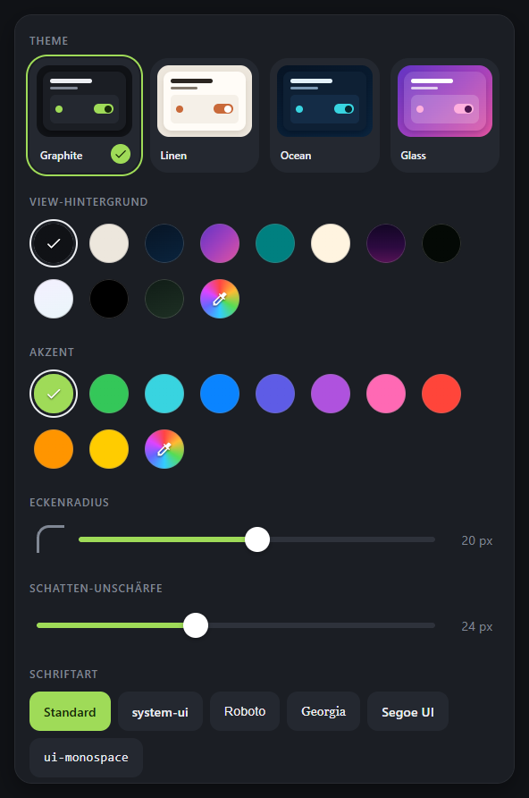

> 🌐 [English](../../en/widgets/theme-customizer-widget.md) | **Deutsch**

# Widget Theme-Anpassung

Mit dem Widget Theme-Anpassung (Theme Customizer) können Nutzer das Aussehen des Dashboards zur Laufzeit ändern — zum Beispiel auf einem Wandtablet: das aktive [Theme](../themes.md) wechseln und seine Werte anpassen — Farben, Ecken, Rahmen, Schatten und Schrift. Welche Werte das Widget anbietet, legst du selbst fest. Alle an das aktive Theme gekoppelten Widgets folgen sofort. Das Widget gestaltet sich selbst im aktiven Theme, wie jede andere gekoppelte Karte: Fläche, Textfarbe, Ecken, Rahmen, Schatten und Schrift.

---

## Widget hinzufügen

1. Öffne einmal den Theme-Manager (Schaltfläche **Themes** im inventwo-Widget-Set der Palette), damit die [mitgelieferten Themes](../themes.md#mitgelieferte-themes) angelegt werden.
2. Ziehe **Theme-Anpassung** aus der Widget-Liste **inventwo design** auf deine Ansicht.
3. Lege unter **Änderungen gelten für** fest, ob eine Auswahl für alle Geräte oder nur für das Gerät gilt, auf dem sie getroffen wird.
4. Kopple deine anderen Widgets in der Gruppe **inventwo - Theme** an **Aktives Theme** (siehe [Widget koppeln](../themes.md#widget-koppeln)).

Im Bearbeitungsmodus zeigt das Widget seinen Inhalt, ändert aber nichts. Probiere es in der Runtime aus.

---

## Bereiche

| Bereich | Was er tut |
|---|---|
| **Theme** | Eine Karte je Theme mit kleiner Vorschau. Ein Tipp auf eine Karte macht dieses Theme zum aktiven Theme. |
| **Farben** (Akzent, View-Hintergrund, Karte, Text, Rahmenfarbe, Schattenfarbe, …) | Runde Farbchips mit Vorschlägen. Ein Tipp setzt diese Farbe im aktiven Theme. Der letzte Knopf (Regenbogen, Pipette) öffnet einen Farbwähler für eine eigene Farbe, inklusive Deckkraft: Beim Ziehen folgen die gekoppelten Widgets live. |
| **Zahlen** (Eckenradius, Rahmenbreite, Schatten-Versatz, -Unschärfe und -Ausdehnung) | Schieberegler mit dem Wert in px. |
| **Rahmenstil** | Knöpfe: Keiner, Durchgezogen, Gestrichelt, Gepunktet, Doppelt, Rille, Grat, Vertieft, Erhaben. |
| **Schriftart** | Knöpfe mit Schriftvorschlägen, jeweils in der eigenen Schrift dargestellt. **Standard** = Schrift der View. |

Akzentfarbe und Eckenradius sind standardmäßig sichtbar; alle anderen Werte schaltest du in den Widget-Einstellungen zu (siehe [Customizer-Gruppen](#customizer-gruppen)). Die Werte erscheinen in der Reihenfolge des Theme-Managers.

> **Theme-Werte gelten immer für alle Geräte:** Farben, Ecken, Rahmen, Schatten und Schrift ändern die Werte (Datenpunkte) des Themes selbst, unabhängig von der Einstellung **Änderungen gelten für**.

---

## Einstellungen

### Common

| Einstellung | Was sie tut |
|---|---|
| **Titel** | Optionaler Titel über den Bereichen. |
| **Änderungen gelten für** | Wo das gewählte Theme gespeichert wird. **Alle Geräte** (Standard): im Datenpunkt `vis-2-widgets-inventwo.0.themes.active`. **Nur dieses Gerät**: im Browser dieses Geräts; es überschreibt dort das globale Theme. **Auswahl durch Nutzer**: Das Widget zeigt einen Schalter **Nur dieses Gerät**, der Nutzer entscheidet selbst. Einschalten behält das aktuelle Theme auf diesem Gerät; Ausschalten folgt wieder dem globalen Theme. |

### Bereiche

| Einstellung | Was sie tut |
|---|---|
| **Themes anzeigen** | Zeigt die Theme-Karten. Standard: an. |
| **Theme-Filter** | Auswahlliste mit allen Themes: Kreuze die Themes an, die als Karte erscheinen sollen. Keine Auswahl = alle Themes. Gelöschte Themes bleiben als „Unbekanntes Theme“ markiert, bis du sie abwählst. |
| **Farbwähler anbieten** | Ergänzt jede Farbe um einen Knopf mit Farbwähler. Aus = nur die Vorschläge sind wählbar. Standard: an. |

### Customizer-Gruppen

Die Gruppen **Customizer: Farben**, **Customizer: Form**, **Customizer: Rahmen**, **Customizer: Schatten** und **Customizer: Schrift** enthalten je Theme-Wert eine Checkbox (gleiche Namen wie im Theme-Manager). Ein angehakter Wert wird im Widget angezeigt.

| Einstellung | Was sie tut |
|---|---|
| **Vorschläge** (jede Farbe) | CSS-Farben, durch Semikolon getrennt, z. B. `#ff9800;rgb(0,150,255);rgba(0,0,0,0.4)`. Leer = Standardvorschläge: zehn Farben beim Akzent, bei allen anderen Farben die Werte aller Themes. |
| **Schriftarten** (Schriftart) | CSS-Schriftarten, durch Semikolon getrennt, z. B. `Roboto, sans-serif;Georgia, serif`. Leer = eine Standardauswahl. |

### Layout

| Einstellung | Was sie tut |
|---|---|
| **Theme-Layout** | **Raster** (Karten umbrechen auf mehrere Zeilen, Standard) oder **Zeile (scrollbar)**. |
| **Kartengröße** | Breite der Theme-Karten: 80–260 px. Standard: 130. |

---

## Tipps

- **Berechtigungen:** Das Widget schreibt Datenpunkte. Hat der vis-Benutzer keine Schreibrechte, zeigt das Widget eine kurze Meldung und es wird nichts geändert.
- **Geräte-Auswahl:** Ein Gerät mit **Nur dieses Gerät** folgt Änderungen von `themes.active` (z. B. durch ein Skript) erst wieder, wenn die Einstellung zurückgestellt wird.
- **Feste Themes:** Widgets, die an ein bestimmtes Theme gekoppelt sind (nicht an **Aktives Theme**), ändern sich beim Wechsel des aktiven Themes nicht — wohl aber bei Änderungen der Werte ihres Themes (z. B. Akzentfarbe oder Ecken).

---

## Siehe auch

- [Themes](../themes.md) — Tokens, Koppeln, Theme-Manager, Datenpunkte, Skripte und CSS-Variablen
- [Presets](../design-presets.md) — Design eines Widgets speichern, anwenden, kopieren und teilen
