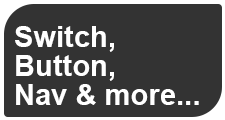
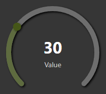
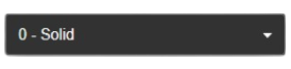

> 🌐 **English** | [Deutsch](../de/index.md)

# inventwo Widgets for ioBroker VIS 2 — User Guide

Welcome to the inventwo widget documentation. This guide explains how to use each widget in the VIS 2 editor to build your own smart home dashboards.

## What are inventwo widgets?

The inventwo widget set adds highly customizable tiles, controls, and display elements to VIS 2. All styling is done directly in the VIS 2 editor sidebar — no CSS knowledge required.

---

## Widget Overview

### Universal Widget
**The most powerful widget in the set.** One tile that can act as a button, switch, navigation link, dialog opener, or read-only status display — and changes its appearance depending on the datapoint value.

→ [Universal Widget](widgets/universal-widget.md)

---

### Slider
**A horizontal or vertical slider for numeric values.** Drag the thumb to set a value, e.g. brightness, temperature, or volume. Fully styled — rail color, active color, thumb shape, and step marks.

→ [Slider Widget](widgets/slider-widget.md)

---

### Radial Slider
**A circular arc slider for numeric values.** Works the same as the regular slider but is displayed as a round dial, great for thermostat-style tiles.

→ [Radial Slider Widget](widgets/radial-slider-widget.md)

---

### Switch
**A toggle switch for on/off or any two-state datapoint.** Looks like a classic on/off switch. Track and thumb are independently styled.

→ [Switch Widget](widgets/switch-widget.md)

---

### Checkbox
**A checkbox for on/off or any two-state datapoint.** Simpler than the switch — just a checkbox with a label.

→ [Checkbox Widget](widgets/checkbox-widget.md)

---

### Table
**Displays a JSON array datapoint as a formatted table.** Sort columns, filter rows, highlight rows by value, and format cells as text, numbers, dates, or images.

→ [Table Widget](widgets/table-widget.md)

---

### Dropdown
**A dropdown menu that reads its options from an ioBroker object's state list.** Select a value and it is written back to the datapoint.

→ [Dropdown Widget](widgets/dropdown-widget.md)

---

### Marquee
**Scrolling text from a datapoint or manually entered text.** Useful for news tickers, status messages, or long labels that don't fit in a fixed space.

→ [Marquee Widget](widgets/marquee-widget.md)

---

### Value List
**Splits a text value into a formatted bullet list.** Great for displaying comma-separated or newline-separated values as a readable list.

→ [Value List Widget](widgets/value-list-widget.md)

---

### Calendar
**A full month calendar view.** Works as a datepicker (read and write a date), a read-only date display, or a today-highlighter — freely combinable, with full color and layout customization.

→ [Calendar Widget](widgets/calendar-widget.md)

---

### Event Calendar
**Shows events in a Google-Calendar-style view.** Month, week, day, multi-month and list views, several calendars at once with a legend, and color rules by event title. Reads the JSON of the ioBroker **ical** adapter directly.

→ [Event Calendar Widget](widgets/event-calendar-widget.md)

---

## Design Presets

Save the design of any inventwo widget as a preset and apply it to other widgets of the same type, copy and paste designs between widgets, or export and import presets as a file. The **Design presets** entry in the widget palette shows all presets with preview pictures and adds a new widget with a preset's design to the view. Only the design is transferred — no datapoints, texts or actions.

→ [Design Presets](design-presets.md)

---

## Coming from vis-1?

The adapter settings contain an assistant that converts the old widgets of the vis-1 adapter **vis-inventwo** in an imported project into the widgets of this set.

→ [Migrating inventwo vis-1 widgets](migration.md)

---

## Where to Start

- **Building a control panel with buttons?** → [Universal Widget](widgets/universal-widget.md)
- **Controlling a dimmer or temperature?** → [Slider Widget](widgets/slider-widget.md) or [Radial Slider Widget](widgets/radial-slider-widget.md)
- **Simple on/off controls?** → [Switch Widget](widgets/switch-widget.md) or [Checkbox Widget](widgets/checkbox-widget.md)
- **Displaying tabular data?** → [Table Widget](widgets/table-widget.md)
- **Picking or displaying a date?** → [Calendar Widget](widgets/calendar-widget.md)
- **Showing events or appointments?** → [Event Calendar Widget](widgets/event-calendar-widget.md)
- **Selecting a mode or scene?** → [Dropdown Widget](widgets/dropdown-widget.md)
