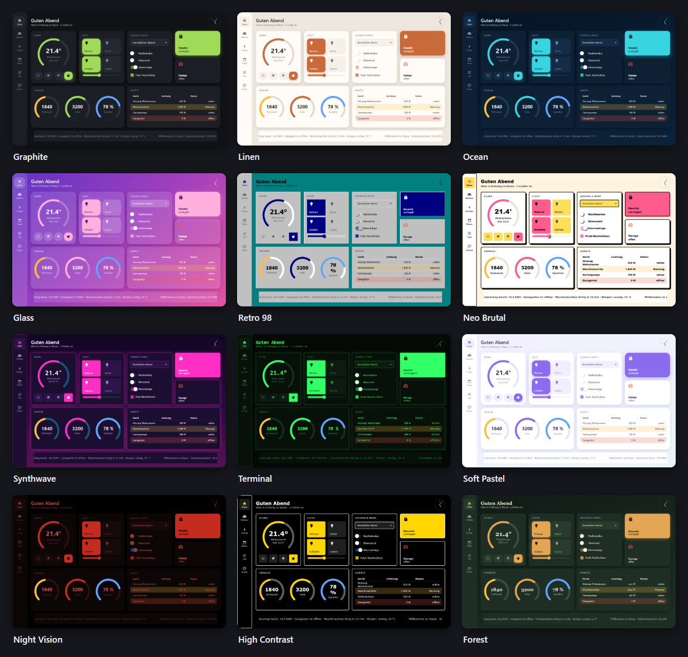
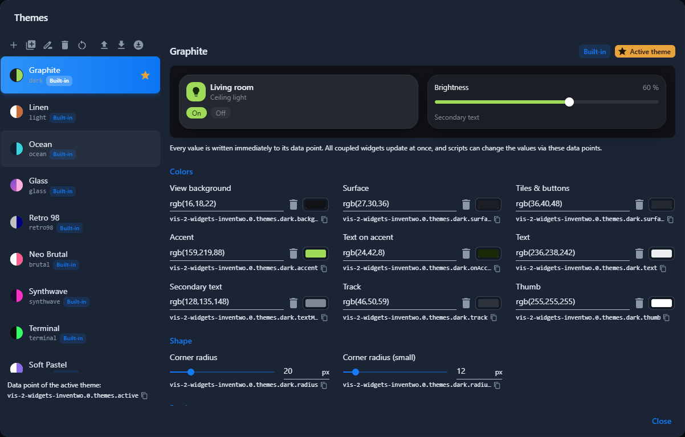
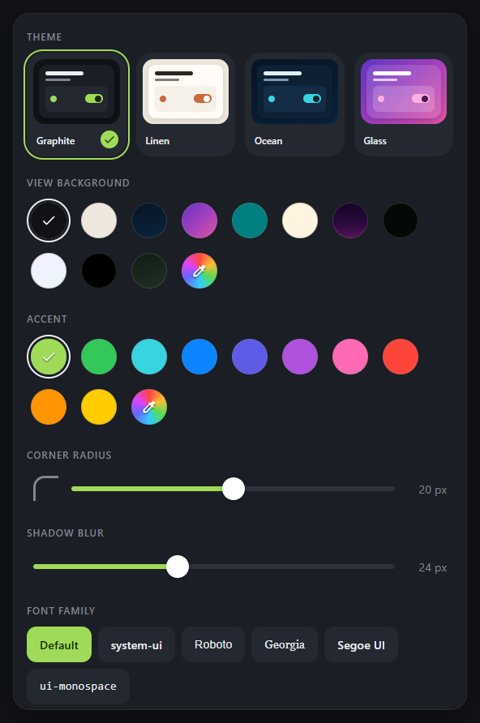

> 🌐 **English** | [Deutsch](../de/themes.md)

# Themes

A theme is a named set of design values — colors, corner radius, border, shadow and font family — that many widgets share. Couple your widgets to a theme and change the look of the whole dashboard in one place: switch from dark to light, pick another accent color or round all corners a bit more, and every coupled widget follows immediately, in the editor and on all devices.

Every value of a theme is an **ioBroker datapoint**. Scripts can therefore switch the active theme (e.g. a light theme during the day and a dark one at night) or change single values (e.g. a red accent color while the alarm system is armed).

Themes are available for **all inventwo widgets**: Universal, Slider, Radial Slider, Switch, Checkbox, Dropdown, Marquee, Value List, Table, Calendar and Event Calendar.

Themes and [presets](design-presets.md) complement each other: a preset copies the **form** of a widget **once** (layout, sizes, spacing, shape), a theme stays **connected** and keeps the **look** of the widgets in sync. Applied to a coupled widget, a preset leaves the theme fields out. Font sizes, sizes and spacing are not part of a theme.

---

## Where to Find It

- **Attribute group** — select an inventwo widget in the VIS 2 editor. The group **inventwo - Theme** is located directly above **inventwo - Presets**. Here you couple the selected widget(s) to a theme.
- **Theme manager** — in edit mode, the inventwo widget set in the widget palette on the left contains the button **Themes** below **Presets**. The manager can also be opened with the icon next to the theme selection in the attribute group (see [Theme Manager](#theme-manager)).
- **Theme Customizer widget** — a widget for the runtime, e.g. on a wall tablet: switch the theme and adjust its values — colors, corners, border, shadow, font (see [Theme Customizer Widget](#theme-customizer-widget)).

---

## Built-in Themes



*The same dashboard in all twelve built-in themes — nothing changed but the theme.*

The adapter ships with twelve themes. They are created as datapoints the first time the theme manager is opened (when no theme exists yet; until then the theme group shows a **Create themes** link for it); **Graphite** becomes the active theme.

| ID | Name | Look |
|---|---|---|
| `dark` | Graphite | Dark, lime accent |
| `light` | Linen | Light and warm, orange accent |
| `ocean` | Ocean | Dark blue, cyan accent |
| `glass` | Glass | Translucent white surfaces on a purple gradient background |
| `retro98` | Retro 98 | Late-90s desktop: gray raised surfaces (border style `outset`), navy accent, square corners, teal background |
| `brutal` | Neo Brutal | Neo-brutalism: thick black outlines, hard offset shadow, yellow tiles, pink accent |
| `synthwave` | Synthwave | 80s neon: dark violet gradient, magenta accent, cyan slider details, glowing edges |
| `terminal` | Terminal | Phosphor screen: green on black, monospace font, dashed outlines |
| `pastel` | Soft Pastel | Light and friendly: pastel lilac, large corners, no border, soft shadow |
| `night` | Night Vision | For wall tablets at night: pure black, dimmed red, no shadow, does not dazzle |
| `contrast` | High Contrast | Maximum legibility, also from a distance: black and white, yellow accent, strong white outlines, no shadow |
| `forest` | Forest | Warm and natural: deep moss green, amber accent, serif font |

The fonts of the built-in themes are fonts installed on the device (e.g. Tahoma, Consolas, Arial Black, Georgia); if one is missing, the browser uses the next font of the list.

Themes added in a newer adapter version are not created automatically when themes already exist: click **Restore missing built-in themes** in the theme manager to add them.

The built-in themes are ordinary themes: they can be changed, renamed and deleted. **Restore missing built-in themes** in the theme manager creates deleted built-in themes again (existing themes are not changed).

In the theme list of the theme manager, built-in themes carry the label **Built-in**. As soon as one of their values differs from the original, the label becomes **Built-in · modified** (the name does not count), and **Reset to original** appears next to the theme name: after a confirmation it writes all built-in values back, the name is kept. A duplicate of a built-in theme is an own theme and has no label.

---

## Theme Values (Tokens)

Each theme contains the following values. The datapoint of a value is `vis-2-widgets-inventwo.0.themes.<theme id>.<token>`, e.g. `vis-2-widgets-inventwo.0.themes.dark.accent`.

| Token | Label | Meaning | Type |
|---|---|---|---|
| `background` | View background | Background of the view. Not applied to widgets, only available as CSS variable `--iw-background` (see [CSS Variables](#css-variables)). Gradients allowed. | Color |
| `surface` | Card | Background of cards: table rows, dialogs, Marquee, Universal widget with theme background "Card". Gradients allowed. | Color |
| `surfaceVariant` | Tiles & buttons | Background of tiles and buttons: Universal widget (default), Dropdown, table header, separated buttons. Gradients allowed. | Color |
| `accent` | Accent | Highlight color: active slider track and thumb, switch "on", checked checkbox, selected day, events, click feedback, active separated button. Gradients allowed. | Color |
| `onAccent` | Text on accent | Text color on accent backgrounds. | Color |
| `onAccentIcon` | Icons on accent | Icon and content color on accent backgrounds (Universal widget: active state with "Accent fill", click feedback). If the value is missing, **Text on accent** applies. | Color |
| `text` | Text | Main text color; also fills the CSS text color (`color`) of the widgets. | Color |
| `textMuted` | Secondary text | Labels, scales, weekdays and other secondary text. | Color |
| `icon` | Icons / content | Icons and content (content color) of the Universal widget, also of inactive separated buttons, and the arrows in the header of the calendar. If a theme has no value (e.g. a theme from an older version), the value of **Secondary text** applies. | Color |
| `track` | Track | Inactive track of sliders, radial sliders and switches. | Color |
| `thumb` | Thumb | Thumb of the switch. | Color |
| `radius` | Corner radius | Corners of tiles, tables and dialogs. | Number (px), 0–100 |
| `radiusSmall` | Corner radius (small) | Corners of small elements: Dropdown, buttons and events of the Event Calendar. | Number (px), 0–100 |
| `border` | Border color | Color of borders and lines. | Color |
| `borderWidth` | Border width | Width of the border of tiles, tables and the Dropdown. | Number (px), 0–20 |
| `borderStyle` | Border style | `none`, `solid`, `dashed`, `dotted`, `double`, `groove`, `ridge`, `inset` or `outset` (the last four draw a 3D edge from the border color). | Text |
| `shadow` | Shadow color (cards) | Shadow of cards (Universal widget with theme background "Card", table) and of all other shadows (slider, switch, dropdown, calendar). | Color |
| `shadowTile` | Shadow color (tiles & buttons) | Shadow of tiles and buttons: Universal widget with theme background "Tile", separated buttons. `rgba(0,0,0,0)` = no shadow. If the value is missing, the shadow color (cards) applies. | Color |
| `glow` | Glow | Shadow color of the active state when **Glow in active state** is checked (Universal widget). If the value is missing, the accent color with 40 % opacity applies. | Color |
| `shadowX` | Shadow X offset | Horizontal offset of the outer shadow. | Number (px), −50–50 |
| `shadowY` | Shadow Y offset | Vertical offset of the outer shadow. | Number (px), −50–50 |
| `shadowBlur` | Shadow blur | Blur of the outer shadow. | Number (px), 0–100 |
| `shadowSize` | Shadow spread | Spread of the outer shadow. | Number (px), −50–50 |
| `fontFamily` | Font family | CSS font family, e.g. `Inter, sans-serif`. Empty = font of the view. | Text |

Colors accept any CSS color string (`#ff9800`, `rgb(...)`, `rgba(...)`, ...).

---

## Coupling a Widget

1. Select one or more inventwo widgets in the editor.
2. In the group **inventwo - Theme** choose a theme in the **Theme** dropdown:
   - **No theme** — the widget is not coupled (default).
   - **Active theme** — the widget follows the theme that is currently active. Switching the active theme (in the manager, by the Theme Customizer widget or by a script) changes the widget too. This is the usual choice.
   - **A specific theme** (e.g. Ocean) — the widget always uses this theme, regardless of the active theme.

### Own value wins
A theme only fills design fields that are **empty**. A field with an own value keeps it. This lets you couple a widget and still give it, for example, its own background color.

When you couple a widget, the fields the theme controls are **cleared**, so that the theme takes effect. Below the dropdown the group shows how many design fields follow the theme (e.g. "12 of 14 fields follow the theme"). If you entered own values afterwards, **Reset own values** clears them again, so all fields follow the theme.

### Decoupling keeps the look
When you set the dropdown back to **No theme**, the current theme values are written into the empty fields. The widget keeps its look and can be edited freely from now on.

### Universal widget: theme background, active state and label
For the Universal widget the group has four additional settings. **Theme background**:

| Option | Background of the widget | Shadow |
|---|---|---|
| **Tile** (default) | Theme value **Tiles & buttons** | **Shadow color (tiles & buttons)** |
| **Card** | Theme value **Card** | **Shadow color (cards)** |
| **None (own background)** | The theme does not set the background; the widget keeps its own background (e.g. a transparent icon button) | The theme sets no shadow |

**Active state** sets how the theme shows the active state: state 1 of a button with one state (e.g. "this view is open" or "light on"), the active button in the mode **Separated buttons**. The setting only appears in these two cases; widgets with several states keep their own state colors.

| Option | Background | Icon | Text |
|---|---|---|---|
| **Accent fill** (default) | Accent | Icons on accent | Text on accent |
| **Subtle (icon in accent color)** | Tiles & buttons (with theme background "Card": Card) | Accent | Text |

**Glow in active state** gives the active state a shadow in the theme color **Glow**, with both options. Unchecked, the active state has the shadow of its surface (cards or tiles & buttons).

**Label** sets the text color in the inactive state: **Text** or **Secondary text**. **Default** uses text, in the mode **Separated buttons** secondary text.

In the inactive state the icon gets the color **Icons / content**, separated buttons use the background **Tiles & buttons**. The click feedback always uses **Accent**, **Icons on accent** and **Text on accent**.

If a field already has an own value (e.g. `contentColor1 = var(--iw-accent)`), it wins here too. For a new selection to take effect, clear the own values with **Reset own values**.

### What the theme controls per widget

| Widget | Controlled design fields |
|---|---|
| Universal | Background, content and text color, border (color, width, style), corners, outer shadow, click feedback, dialog (background, title, close button, corners), analog clock colors, states (see above) |
| Slider | Track, active track, thumb, shadow colors |
| Radial Slider | Track, active track, thumb, shadow colors, value, needle, label and scale colors |
| Switch | Track off/on, thumb, shadow colors |
| Checkbox | Box color, active color |
| Dropdown | Text, background, highlight, border (color, width), corners, title color, shadow colors |
| Marquee | Background |
| Value List | Bullet color |
| Table | Header and row backgrounds, lines and border, corners, outer shadow |
| Calendar | Header, weekday, day, today, selected day, week number and hover colors, shadow of the selected day |
| Event Calendar | Header and header buttons, days, today, events, borders, corners, secondary texts |

In addition, the theme fills the text color (`color`) and — if the theme has a font family — the font family of the CSS settings of every coupled widget, as long as they are empty.

### "From widget" references
If a design group uses **From widget** and the referenced widget is coupled to a theme, its empty fields are filled from its theme as well.

---

## Theme Manager



Open it with **Themes** in the inventwo widget set of the palette (edit mode) or with the icon next to the theme selection in the attribute group. The dialog shows the themes on the left (with a color swatch; the active theme is marked with a star) and the values of the selected theme on the right, grouped into **Colors**, **Shape**, **Border**, **Shadow** and **Font**, together with a live preview.

| Action | What it does |
|---|---|
| **New theme** | Creates a new theme with the values of the default theme. |
| **Duplicate theme** | Creates a copy of the selected theme (name "… (copy)"). |
| **Rename theme** | Changes the display name. The ID (and therefore the datapoints) stays the same. |
| **Delete theme** | Deletes the theme (after confirmation). Its datapoints stay in the object tree, marked as deleted, and are reused when a theme with the same ID is created again; they can be removed in the admin. Widgets coupled to this theme then use their own values. If it was the active theme, another theme becomes active. |
| **Restore missing built-in themes** | Creates deleted built-in themes again. |
| **Import themes** | Creates the themes of an exported file as new themes (see [Exporting and Importing Themes](#exporting-and-importing-themes)). |
| **Export theme** | Saves the selected theme as a JSON file. |
| **Export all themes** | Saves all themes in one JSON file. |
| **Set as active** | Makes the selected theme the active theme for all devices. |

Every change is written **immediately** to its datapoint; all coupled widgets update at once. The ID of every datapoint can be copied with the copy icon, e.g. to use it in a script.

The ID of a new theme is derived from its name (lowercase letters, digits and `_`), e.g. "My Theme" becomes `my_theme`.

### Exporting and Importing Themes

Themes can be saved as a file and passed on, e.g. to share a theme with other users or to move it to another ioBroker installation. The buttons are in the toolbar above the theme list, after the divider:

- **Import themes** — opens a file dialog; choose a `.json` file exported before. A file may contain one or several themes.
- **Export theme** — downloads the selected theme as `<name>.json`.
- **Export all themes** — downloads all themes in one file `inventwo-themes.json`.

The file is plain JSON with the name, the ID and all [theme values](#theme-values-tokens) of each theme. Importing **always creates new themes** — existing themes are never overwritten. If a theme with the same ID or name already exists, the imported theme is renamed (e.g. "Ocean (2)") and gets its own ID. Invalid values in the file are ignored (the default value is used instead); at most 50 themes are imported per file. After the import the first imported theme is selected.

---

## Datapoints and Scripts

| Datapoint | Content |
|---|---|
| `vis-2-widgets-inventwo.0.themes` | Folder of all themes |
| `vis-2-widgets-inventwo.0.themes.active` | ID of the active theme (e.g. `dark`), writable. Empty = no active theme |
| `vis-2-widgets-inventwo.0.themes.<id>` | Channel of a theme; its name is the display name |
| `vis-2-widgets-inventwo.0.themes.<id>.<token>` | One datapoint per [theme value](#theme-values-tokens): text for colors, border style and font family, number (px) for the numeric values |

Changes of these datapoints reach the open views immediately — no vis bindings are involved. Invalid values (e.g. text in a number datapoint or an unknown border style) are ignored; the widgets then use the default value of this token.

### Example: light during the day, dark at night (JavaScript adapter)

```javascript
// 07:00: light theme
schedule('0 7 * * *', () => {
    setState('vis-2-widgets-inventwo.0.themes.active', 'light');
});

// 22:00: dark theme
schedule('0 22 * * *', () => {
    setState('vis-2-widgets-inventwo.0.themes.active', 'dark');
});
```

With astro times instead of fixed times: `schedule({ astro: 'sunrise' }, ...)` and `schedule({ astro: 'sunset' }, ...)`.

### Example: change the accent color

```javascript
// Red accent while the alarm system is armed, lime otherwise
on({ id: 'alarm.0.armed', change: 'ne' }, obj => {
    setState('vis-2-widgets-inventwo.0.themes.dark.accent', obj.state.val ? 'rgb(255,69,58)' : 'rgb(159,219,88)');
});
```

Numeric values are written as numbers, e.g. `setState('vis-2-widgets-inventwo.0.themes.dark.radius', 8);`.

> **Note:** A device on which the active theme was chosen with **This device only** (see [Theme Customizer Widget](#theme-customizer-widget)) keeps its own choice and does not follow `themes.active` until the setting is switched back.

---

## CSS Variables

The values of the active theme are also available as CSS variables in every view. Use them anywhere CSS is accepted. Other widgets (also from other widget sets) can use the variables in their CSS fields too, e.g. `color: var(--iw-text)`.

### View background that follows the theme

The background belongs to the view, not to a widget. To make it change together with the theme, enter the variable `--iw-background` in the settings of the view:

1. Click an empty spot of the view in the editor, so that no widget is selected.
2. Open the tab **View** in the attribute panel on the right and there the group **CSS background (background-...)**.
3. Leave **Image** and **Background class** empty. Only then the checkbox **One parameter** is shown.
4. Check **One parameter**. The single fields (`-color`, `-image`, `-repeat` …) disappear and the field **background** appears instead.
5. Enter `var(--iw-background)` in the field **background**.

Without the checkbox there is only the field `-color` (`background-color`). That is not enough: some themes (e.g. Glass, Synthwave, Forest) use a gradient as background, and only `background` can show it.

This is set per view: every view whose background should follow the theme needs this entry.

| Variable | Token |
|---|---|
| `--iw-background` | View background |
| `--iw-surface` | Card |
| `--iw-surface-variant` | Tiles & buttons |
| `--iw-accent` | Accent |
| `--iw-on-accent` | Text on accent |
| `--iw-on-accent-icon` | Icons on accent |
| `--iw-text` | Text |
| `--iw-text-muted` | Secondary text |
| `--iw-icon` | Icons / content |
| `--iw-track` | Track |
| `--iw-thumb` | Thumb |
| `--iw-radius` | Corner radius (with `px`) |
| `--iw-radius-small` | Corner radius (small) (with `px`) |
| `--iw-border` | Border color |
| `--iw-border-width` | Border width (with `px`) |
| `--iw-border-style` | Border style |
| `--iw-shadow` | Shadow color (cards) |
| `--iw-shadow-tile` | Shadow color (tiles & buttons) |
| `--iw-glow` | Glow |
| `--iw-shadow-x` | Shadow X offset (with `px`) |
| `--iw-shadow-y` | Shadow Y offset (with `px`) |
| `--iw-shadow-blur` | Shadow blur (with `px`) |
| `--iw-shadow-size` | Shadow spread (with `px`) |
| `--iw-font-family` | Font family (`inherit` if empty) |

The variables are set as soon as an inventwo widget has been loaded in the view and a theme is active.

---

## Theme Customizer Widget



The **Theme Customizer** widget lets users change the theme at runtime, e.g. on a wall tablet. It is styled with the active theme itself and shows:

- **Theme** — one card per theme with a small preview; tap a card to make it the active theme.
- **Theme values** — every value of the theme manager can be switched on: colors as chips with own suggestions and a color picker, numbers as sliders, border style and font as buttons. Accent color and corner radius are shown by default.

In edit mode the widget shows its content but does not change anything.

| Setting | What it does |
|---|---|
| **Title** | Optional title above the sections. |
| **Apply changes to** | **All devices** (default): the active theme is written to the datapoint `themes.active`. **This device only**: the choice is stored in the browser of this device and overrides the global theme there. **User chooses**: the widget shows a switch **This device only**, so the user decides. |
| **Show themes** | Shows the theme cards. |
| **Theme filter** | Dropdown with all themes, several can be checked. No selection = all themes. |
| **Offer color picker** | Adds a color picker button to every color. |
| **Customizer groups** | One checkbox per theme value (Colors, Shape, Border, Shadow, Font); colors and fonts take own suggestions. See [Theme Customizer Widget](widgets/theme-customizer-widget.md#customizer-groups). |
| **Theme layout** | **Grid** (cards wrap to several lines) or **Row (scrollable)**. |
| **Card size** | Width of the theme cards (80–260 px). |

> **Theme values always apply to all devices:** they change the values of the theme itself (its datapoints), not only the selection on this device.

Writing the datapoints requires write permission for the vis user; if a change cannot be saved, the widget shows a short message.

→ [Theme Customizer Widget](widgets/theme-customizer-widget.md)

---

## Storage and Backup

Themes are stored as datapoints under `vis-2-widgets-inventwo.0.themes`, so they are available in **all projects** and on **all devices** and are part of a normal ioBroker backup. Each browser additionally keeps a copy of the themes in its local storage, so the widgets already show the right colors while the view is loading.

---

## See Also

- [Presets](design-presets.md) — copy a complete design between widgets
- [Theme Customizer Widget](widgets/theme-customizer-widget.md)
- [Styling and Shapes](widgets/universal/styling-and-shapes.md) — all style groups of the Universal Widget
